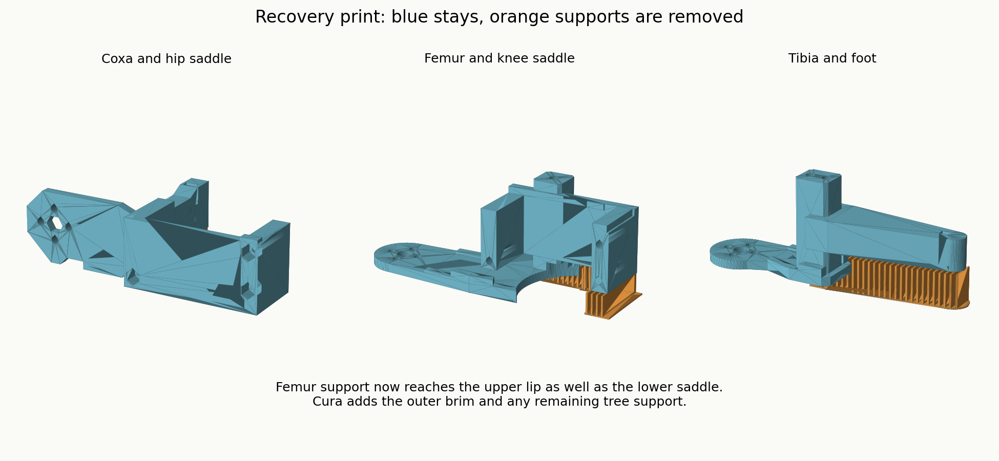
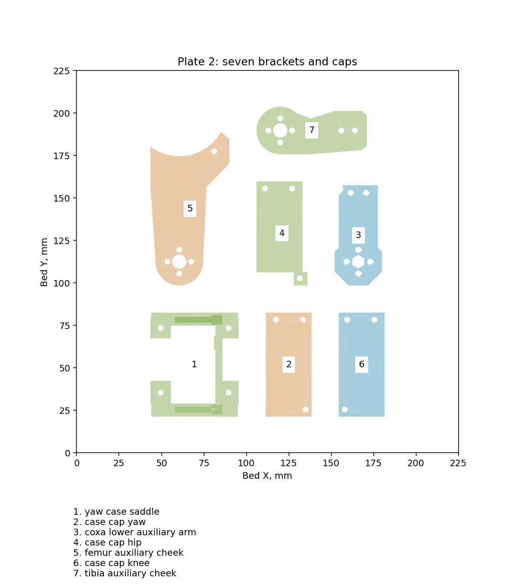

# MIST robot: CAD, printing and build log

A four-legged robot using STS3215 servos and a Xiaomi Mi 9 SE mounted vertically in landscape orientation on a rotating phone mount. The phone is intended to provide the voice/face interface and camera view. This repository documents the physical prototype, its design iterations and supporting software.

**Current physical progress:** two complete legs and the centre hub were reported built. The corrected recovery print and fourth-leg package were prepared, but their final print/fit results have not been reported. Walking, full-load strength and the complete phone integration are not established physical results.

## Start here

- [Current illustrated assembly and inspection checklist](design/assembly_handoff_20261008/Inspection_And_Assembly.html) (download and open locally for the interactive HTML).
- [Current fourth-leg instructions](design/fourth_leg_20260917/print/START_HERE.txt).
- [Mechanical requirements](design/single_leg_r7_wide_joints_20260914/REQUIREMENTS.md).
- [Materials and inventory](docs/mist/MIST_ACTUAL_INVENTORY.md), [available parts](docs/mist/MIST_AVAILABLE_PARTS.md), [material dimensions and masses](docs/mist/MIST_MATERIAL_DIMENSIONS_MASS.md).
- [Cart and historical purchasing plan](docs/mist/MIST_MASTER_BASKET.md). Historical prices and orders are dated records, not current quotes.
- [Progress and revision guide](PROJECT_PROGRESS.md).
- [Software overview](brain/README.md). The separately published interface project is [silmoon04/mist](https://github.com/silmoon04/mist).

## Download CAD and print files

[All release downloads](https://github.com/silmoon04/mist-robot/releases/tag/build-2026-10-12)

| Download | Contents |
| --- | --- |
| [Fourth leg](https://github.com/silmoon04/mist-robot/releases/download/build-2026-10-12/Fourth_Leg_Print_Set.zip) | Ten parts on two plates, corrected removable supports, Cura profile and instructions. Reuse four existing spacers. |
| [Recovery plate](https://github.com/silmoon04/mist-robot/releases/download/build-2026-10-12/Recovery_Three_Parts.zip) | The three largest parts with the corrected support arrangement. |
| [Balanced recovery profile](https://github.com/silmoon04/mist-robot/releases/download/build-2026-10-12/Recovery_Balanced_Profile.zip) | Updated 0.28 mm profile. Select it explicitly in Cura. |
| [Hub and spacers](https://github.com/silmoon04/mist-robot/releases/download/build-2026-10-12/Hub_And_8_Corrected_Spacers_5p5D_13H.zip) | Centre hub and 13 mm tall, 5.5 mm OD spacers. |
| [CAD and media archive](https://github.com/silmoon04/mist-robot/releases/download/build-2026-10-12/robot-cad-and-media.zip) | STEP, STL, Fusion, 3MF, profiles, generated pictures and videos across the saved design revisions. Extract at the repository root to restore the original directory layout. |

The source and documentation live in Git; large CAD/media exports live in release assets. Historical candidates are included for traceability and must not be treated as current production-ready parts. No new license is assigned to third-party reference material.

## Latest manufacturing revision

The full fourth-leg set is split into two plates to leave room for supports and the brim. Estimated printing is 6 h 14 min plus 4 h 41 min, about 187 g PLA total on an Elegoo Neptune 4 Pro. These are slicer estimates.

The latest process uses 0.28 mm layers, five walls, 25% gyroid infill and a 6 mm outer brim. The femur has support beneath the previously missed upper lip. The femur/tibia bridge closures use three M3 inserts, 4 mm OD by 5 mm length, and M3x10 screws with 0.5 mm washers. The old M3x30 bridge instructions do not apply to those insert connections.

## Layout

`design/` contains the quadruped CAD generators, requirements, simulations and manufacturing history. `docs/mist/` contains inventory, materials, wiring and earlier wheel-leg planning. `mist_3d/` contains earlier CAD work. `firmware/`, `brain/`, `sim/`, `tools/` and `bench/` contain supporting project source. Older wheeled concepts are historical; the current mechanical handoff is the direct-drive quadruped above.

Private credentials, Wi-Fi secrets, personal conversation memory, recordings, runtime logs, dependency installations and temporary analysis caches are excluded. Use `.env.example` and firmware secret examples for local configuration. Publication does not establish physical assembly, load capacity or autonomous operation.
