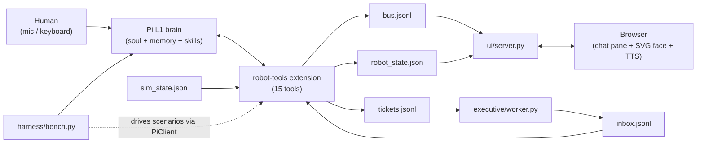
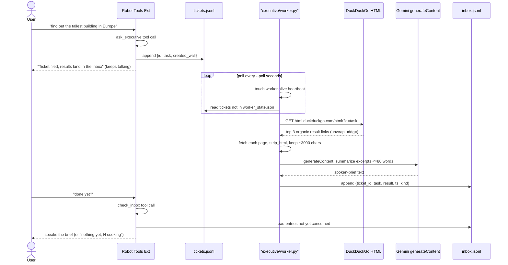
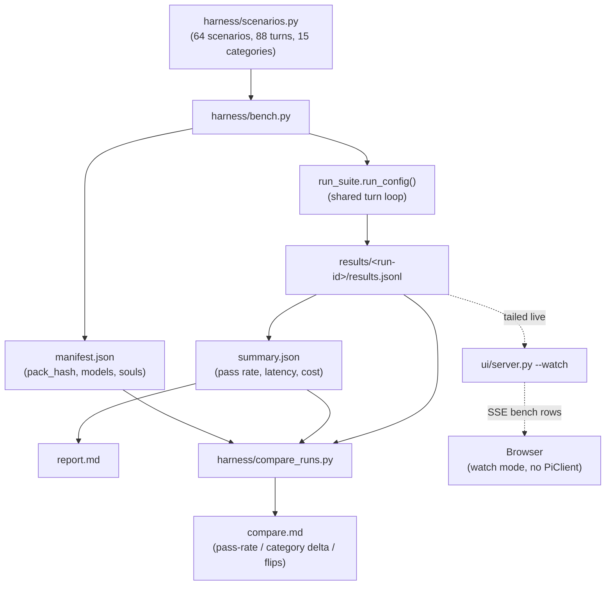
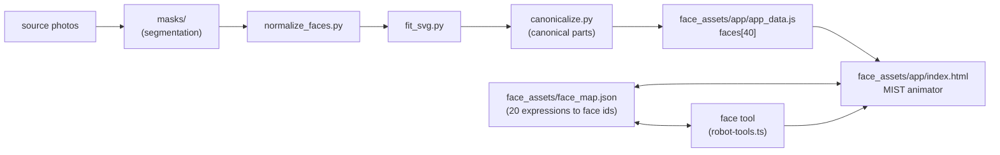

# HEX-1 brain — architecture

HEX-1 is a wheel-leg quadruped (4 legs x 3 DOF + 4 wheel-hub servos: 16
active ST-3215 bus servos, of 18 bought). This doc maps the software that makes up its "L1"
voice brain: the Pi-based LLM loop, the simulated tool belt, the chat UI, the
background executive worker, the benchmark harness, and the SVG face
pipeline. See `docs/SPECS.md` for the binding interface contract; this doc is
descriptive, not authoritative.

## 1. System overview



The extension (`extensions/robot-tools.ts`) is the only thing that touches
"hardware" today — it simulates the L0 spine, tracking position/pose/face in
memory and persisting every call to `bus.jsonl` plus the latest snapshot to
`robot_state.json`. The chat UI server and the benchmark harness are two
different consumers of the same `PiClient` + run-dir contract; the executive
worker is an independent process that only talks to the run dir's
`tickets.jsonl` / `inbox.jsonl` / `worker.alive`.

## 2. Sequence — one chat turn

```mermaid
sequenceDiagram
  actor User
  participant Browser
  participant Server as UI Server
  participant Client as PiClient
  participant Pi as "pi --mode rpc"
  participant Tools as Robot Tools Ext

  User->>Browser: types message, hits send
  Browser->>Server: POST /api/say {text}
  Server-->>Browser: 202 accepted (or 409 busy)
  Server->>Client: ask(prompt, on_event)
  Client->>Pi: RPC prompt over warm process
  Pi->>Tools: tool_execution_start / tool_execution_end
  Tools-->>Tools: writes bus.jsonl + robot_state.json
  Pi-->>Client: message_update text_delta events
  Client-->>Server: on_event callback per raw RPC event
  Server-->>Browser: SSE text_delta / tool_start
  Server->>Server: tails bus.jsonl (source of truth for tool_end/state)
  Server-->>Browser: SSE tool_end + state
  Pi-->>Client: agent_end, final reply text
  Client-->>Server: TurnResult (text, ttft_s, tokens, cost_usd, ...)
  Server-->>Browser: SSE turn_end
  Browser->>Browser: face tool_end -> face_map lookup -> selectFace(); reply spoken via Browser/Deepgram TTS
```

`/api/say` returns immediately (202); everything else streams over
`/api/events` (SSE). The server deliberately sources `tool_end` and `state`
from `bus.jsonl` rather than the RPC stream to avoid double-counting tool
calls the RPC layer might miss.

## 3. Sequence — executive research round trip



`check_inbox` only falls back to `sim_state.json`'s canned
`executive_results` when `worker.alive`'s mtime is more than 20 s old — with
a live worker process, real research always wins. Any network step in the
research pipeline (search, fetch, summarize) degrades gracefully; total
failure still delivers a `kind="error"` inbox entry rather than leaving a
ticket to rot silently.

## 4. Flow — benchmark run



`bench.py` is a thin driver over `run_suite.run_config()` — it does not
reimplement the turn loop. `--plan` prints the config x scenario x repeat
matrix and exits with no network calls, which is what the offline gate
exercises. `compare_runs.py` matches scenarios by id+turn only when both
runs' `pack_hash` agree (a sha256 of the scenario pack); otherwise it warns
loudly and restricts the diff to shared scenario ids.

## 5. Face pipeline



`face_assets/` is a one-way offline build pipeline (photos through to
`app_data.js`) plus a small runtime layer on top: `face_map.json` maps each
of the 20 tool-level expressions to a primary SVG face id (plus 1-3 alts),
grounded in `classifications.json`'s part descriptions.
`harness/check_face_map.py` validates the map against both `app_data.js` and
the `EXPRESSIONS` array parsed straight out of `robot-tools.ts`, so the map
can never silently drift from the tool's actual expression list.

## Data contracts at a glance

| file | writer | reader(s) |
|---|---|---|
| `results/<run>/bus.jsonl` | robot-tools extension (every tool call) | `ui/server.py` (chat + watch tail), `harness/*` |
| `results/<run>/robot_state.json` | robot-tools extension | `ui/server.py` (`state` SSE events) |
| `results/<run>/sim_state.json` | test harness / `ui/server.py` `/api/sim` | robot-tools extension (read fresh per call) |
| `results/<run>/tickets.jsonl` | robot-tools extension (`ask_executive`) | `executive/worker.py` |
| `results/<run>/inbox.jsonl` | `executive/worker.py` | robot-tools extension (`check_inbox`) |
| `results/<run>/worker.alive` | `executive/worker.py` heartbeat | robot-tools extension (liveness check) |
| `results/<run-id>/results.jsonl` | `harness/bench.py` / `run_suite.py` (one row per turn) | `harness/compare_runs.py` (flips), `ui/server.py --watch`, `voice_check.py --from-results` |
| `results/<run-id>/{manifest,summary,report.md}` | `harness/bench.py` | `harness/compare_runs.py`, humans |
| `face_assets/face_map.json` | hand-authored, validated by `check_face_map.py` | `ui/server.py` (`/api/config`), browser face logic |

## Processes and how they run

- **Chat UI (interactive)**: `python ui/server.py` — one warm `PiClient`,
  one turn at a time, everything streamed to the browser over SSE.
- **Chat UI (spectate a benchmark)**: `python ui/server.py --watch results/<run-id>`
  — no `PiClient`, tails `bus.jsonl` + `results.jsonl` of the newest run
  subdirectory under the given path.
- **Executive worker**: `python executive/worker.py` — independent process,
  polls a run dir, safe to run against the same `--run-dir` the UI server
  uses so `ask_executive`/`check_inbox` round-trip for real.
- **Benchmark**: `python harness/bench.py` — headless, spawns its own
  `PiClient` per config via `run_suite.run_config()`, writes everything
  under `results/<run-id>/`.
