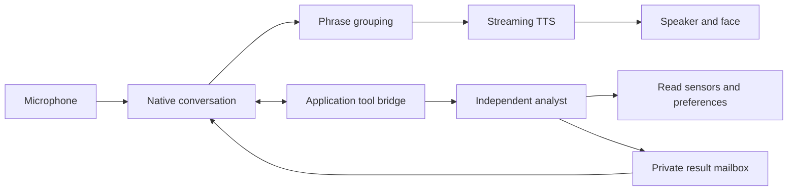

# MIST layered conversation and phrase streaming

The conversation and background reasoning now run independently. Native Codex V3 retains the live microphone and conversation. Its existing Spark tool bridge can start a separate Spark analyst, receiving a job receipt without waiting for the answer. ElevenLabs Flash v2.5 produces speech from phrase chunks using the same MIST voice and one synthesis context per reply.

## Coordination

The new tools are start_background_task, background_task_status and cancel_background_task. Controls also offer a typed background question and Cancel analysis. A single analyst runs at a time, with bounded output and a 45-second reasoning limit. Duplicate requests in the same user turn reuse the existing job. The analyst has no motion, filesystem, shell or preference-write tools.

Results are summaries and tool receipts, not inner reasoning traces. A completed result can be supplied privately to the conversation when the original user turn is still current and user speech, playback and tool delegation are idle. Otherwise it remains available for an explicit follow-up. Cancellation prevents late results from publishing. Ending the conversation closes the independent model process, including cancellation during startup.

## Speech and expression

Text is grouped at full sentences or substantial comma/semicolon clauses, keeping short prefaces and decimal values intact. An unpunctuated stream has a 140-character whole-word fallback. The same TTS context remains open across all phrases, preserving continuity. The prompt favors a short useful opening, natural clause punctuation and varied rhythm. Automatic happy or curious expressions use conservative opening-word cues once per reply at playback start; manual selections take priority. No voice identity change, pitch shift or spoken emotion tags were introduced.

## Evidence and latency

A live test started real background reasoning during an ongoing spoken story. The application acknowledged the request in 0.65 ms; the analyst completed in 5.54 seconds, using its tools while 39 speech packets continued to reach the client. This acknowledgement excludes the model-routing delay before an application request arrives.

A separate conversational test started work through the model, accepted more spoken input, answered a greeting, and retrieved the completed result through background_task_status. Native voice combined that additional input with the current user turn, so the separate story probe supplies the stronger evidence for simultaneous speech and reasoning.

The standalone analyst used a real sensor tool. After moving startup imports off the event loop, its longest observed 20 ms heartbeat interval was about 35.7 ms. This is one desktop measurement, not a real-time scheduling guarantee.

In controlled phrase tests, first audio improved from 766 to 594 ms for a longer clause and from 765 to 204 ms for short sentences. Independent speech recognition recovered all words in both new recordings. These are two examples at a fixed text-input cadence, not a guarantee for every response.

Two ordinary spoken conversations returned first audio packets about 1.80 seconds after the final synthetic input frame. The browser adds its existing 200 ms reserve, keeping total ordinary response near two seconds. Native turn detection still sets that floor; background task routing and tool-dependent answers can take longer.

All 33 application, 12 TTS, seven phrasing, three background lifecycle and six legacy recovery contracts passed, along with playback checks, expression cues and 31,050 renderer states. Cancellation, stale result suppression, microphone forwarding and private idle delivery have deterministic coverage. Human-perceived prosody and real handset echo remain listening tests.

Evidence: brain/results/layered_brain_20260914. LAYERED_REPORT.json contains measurements and implementation hashes. Earlier reports remain historical. The default service is still python brain/duplex/server.py on port 8790. Background Spark can be selected through MIST_BACKGROUND_MODEL without changing the conversation model.
