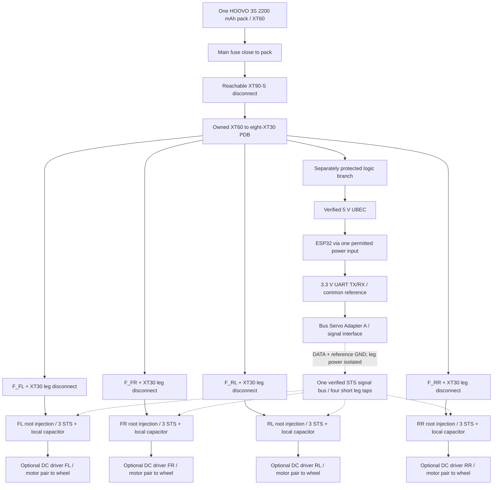
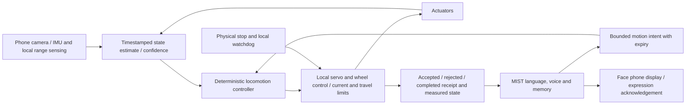

# MIST candidate assembly and wiring

This is the integration plan for the September candidate. The first deliverable to print is the fit bed. The new leg and body remain candidate geometry, with unresolved transmission, fastener and attachment details. They are not approved first-leg print files. Nothing in this work operated hardware or purchased parts.

Update 7 September: the checked detailed CAD is in `cad/leg_output_checked_20260907`, using 139.5 mm femur, four off-centre M4 anchors per hip and 8 mm knee shafts. Belts have not been bought; Gates 375-3MGT-09 and matched 32T metal pulleys are selected. The new detailed mass accounting is 6.341 kg under solid-print and hardware-envelope assumptions, not a measured weight. Its continuous-load sensitivity fails. The earlier 140 mm / 3.953763 kg calculations discussed below are retained as earlier evidence and do not approve the updated assembly. See `simulation/cad_mass_20260907` and the current CAD delivery notes before using a dimension or mass for manufacturing.

The plan uses [the recovered inventory](history_inventory.md), [the mechanical study](mechanical_audit.md), [the wheel study](wheel_motor_study.md), the shared [simulation parameters](simulation/parameters.json), [body geometry report](cad/output/body_geometry_report.json), [coupon recipe](coupons/coupon_recipe.json), and [brain change record](brain_changes.md). The native Fusion scripts still need an actual Fusion run and export; offline CAD checks do not establish that execution.

## One coordinate system through assembly and control

Use +X forward, +Y left and +Z upward. The origin is the body hip-yaw mounting plane. The body bottom is Z = −35 mm. Body recipe coordinates start at the bottom, so subtract 35 mm from their Z values before comparing them with the simulation. A ground-referenced height also needs the current hip-plane world height added.

The current candidate has a 180 mm diameter body, 220 mm main barrel and 260 mm barrel/lid/handle height. Hip axes lie at radius 103 mm at FL +45°, FR −45°, RL +135° and RR −135°. The leg has a 35 mm radial and handed 30 mm transverse hip offset, 140 mm femur, 130 mm tibia and 85 × 24 mm wheel. Handed coxa geometry makes left and right assemblies different even when they share links.

Yaw rotates around vertical +Z. Hip and knee rotate about local −Y, with zero links pointing down. The remote femur belt is 1:1; any extra reductions sit proximally. For the chosen absolute-tibia topology, motor coordinates are `s = [ry*q1, rh*q2, rk*(q2+q3)]`. The default ratios are presently 2:1; the 3.5:1 hip case is an investigation, not a released replacement. Hardware calibration must include both this coupling and the final ratio/neutral choice. The old 110/70 mm parallelogram, old roll/yaw naming and historical raw servo ticks do not define the new assembly.

## Fit beds before the leg

Print [MIST_BED1_ALL_PARTS.3mf](coupons/bed1/MIST_BED1_ALL_PARTS.3mf) using the selected material and intended process. It contains seven handled parts within 206 × 202.5 × 10 mm, checked as closed geometry. The 75.346 cm³ model volume corresponds to approximately 93.43 g of fully solid PLA; the slicer supplies the actual material and time estimate. The bed combines full-depth bearing bosses, hardware interfaces, a servo-width gauge, a split clamp and a separate 624 bearing boss/retainer. It does not prove the selected belt tooth profile, motor cartridge or final servo horn clamp.

Record the part, measured hardware and result in [feedback_BED1.csv](coupons/feedback_BED1.csv). Keep failed stations in the record. A fit that needs a hammer is a failed removable bearing interface. The prior thin 13.25 mm ring passed, but the thicker leg needed hammering; this is why full-depth bosses and a retainer are on this bed. Measure how the retained bearing rotates after the cap is tightened, not only whether its OD enters the pocket.

Keep bearing diameter compensation separate from servo width, screw clearance, shaft fit and insert pilot diameter. The inserts have no reliable recovered outer diameter or length. A heat insert that enters a test hole does not qualify its pullout resistance. Printed shaft gauges characterize print size; the loaded mechanism uses metal shafts.

The refinement tool accepts measured feedback and creates a separate request:

```powershell
python coupons/refine_from_feedback.py coupons/feedback_BED1.csv --out coupons/refinement_request.json
```

Run that from this package directory only after entering real results. It rejects an untouched form. The next generated bed should retain only unresolved fits and representative mating stacks. After the second print, record its actual material, process and measurements before applying values to final leg/body geometry. Do not mark a candidate fit as passed because a new diameter lies between two earlier stations.

## Assemble one unpowered leg before replication

The sequence below describes the required completed mechanism; the current drawings/scripts do not yet provide every part listed. A prepared bearing reference or pulley envelope is not the corresponding manufactured shaft, retainer or toothed transmission.

1. Assemble the hip support on a bench fixture with the load reacted into a board or rigid frame. Fit the accessible inserts, bearing outer races, shoulders and removable caps first. Pass smooth metal shafts through the inner races with spacers that contact only those races. The yaw axis needs two separated supports to carry the transverse-offset bending moment. The servo horn transmits torque and must not be the only foot-load bearing.
2. Install the independent hip and knee-input trunnions and their proximal reductions while both sides remain accessible. The two shafts on the nominal common axis must stop before they meet. Verify independent free rotation, then install the real servo horns and centre screws with a straight tool path. Check case preload and axial location; the old cap's visible gap is a documented failure, not a tolerance to reproduce.
3. Assemble femur, knee axle and tibia with the real 1:1 belt and matching pulley profile. Choose an available closed belt and set the centre distance from its pitch length. Tension through the intended idler/block without silently changing link length. Record the adjustment position and reversal play. Account for belt pretension in bearing support; an unloaded freely moving belt can still impose a large lateral load on its shafts.
4. Install one wheel cartridge. For FIT0493, reserve 61 mm gearbox-face-to-encoder-rear plus its 12 mm output shaft and cable bend space. Put the wheel on a separately supported axle, with a torque coupling from the motor. Do not turn the motor's 4 mm shaft into an unsupported foot spindle. For the STS alternative, assemble the full two-stage speed increase and its supports before weighing or comparing it.
5. Route the leg wiring before covers. Fix each cable at a stationary point on both sides of a rotating joint, with the flexing loop between them. Hand-cycle yaw, hip and knee separately, then combinations at the travel boundary. The loop must neither become taut nor enter a pulley, gear mesh, bearing retainer or wheel. Use the real connector bodies and strain relief in this exercise.
6. Add cosmetic covers only after the shafts, horn screws, tension adjustment and cable inspection remain accessible. Write a disassembly order that reaches each servo and the wheel motor without destroying glued joints or pulling a bearing through an inaccessible wall.

Print long link cheeks broad-face-down so continuous roads surround bearing bosses and run along the bending load path. Use through-fasteners and metal spacers to clamp the stack. Inserts retain covers or brackets; they are not rotating journals or substitutes for a double-shear shaft support. A vertical thin adapter repeats the previous layer-splitting failure. Shell walls and the lid handle are cosmetic: the body deck and core carry the mass. Long core ties need actual hardware of the right length; four nominal M3 ties in CAD do not establish that those rods are owned.

Before this leg becomes a print release, the mechanism still needs actual reduction teeth/centres, horn interfaces, independent trunnion supports, shaft lengths and retainers, counted bearing allocation, measured fasteners with engagement and tool access, finished root attachment, tension adjustment, selected wheel cartridge and cable clearances. Native Fusion execution, full-motion interference results, fit feedback and the loaded torque/thermal envelope must all describe that same geometry revision.

## Supported powered bench, then four legs

Keep the first assembled leg externally supported with its wheel clear and its load path visible. Commission one servo at a time before connecting a shared bus, recording its label, ID, direction and usable travel. Disconnect motor power before moving bus plugs. FE-URT is the temporary bench master; it does not operate in parallel with the ESP32 as a competing bus master.

Keep `spider-robot/bench/leg_calibration.json` unchanged. Create a new revision-specific calibration record under this package when real measurements exist. Record serial/label identity, role, ID, mechanical reference, raw endpoints, direction, selected reduction ratios, absolute-tibia coupling, excluded collision regions and parameter-file hash. Do not copy the old 3075 / 1386 / 2085 centres or the old 50–158°/s UI settings into the new leg. The first motion range comes from its measured free travel and transmission travel limit.

Use a removable smoke stopper for static wiring/polarity checks, then remove it for controlled motion after those checks; its current restriction can otherwise imitate a brownout. Start at small motion and load, watching current, voltage and case temperature. The recovered yaw event reached 52 °C. Preserve the existing 50 °C software cutoff during commissioning, with a lower limit if a component or print requires it. A cool case does not establish winding temperature, and a fuse does not prevent motor overheating during a stall.

Measure output angle or wheel position independently of servo telemetry during forward/reverse loaded motion. Record clamp movement, bearing drag, belt skip, backlash, deflection, response delay and temperature trend separately. Replace the simulator's assumed delay, stiffness, backlash and drive-current limits with those measurements before expanding speed. A brief unloaded sweep is insufficient evidence for a supported stance or a stair transition.

One possible final ID allocation is below. It is a proposal for the rebuilt robot, not a command to rewrite the current servos. Assign only when each physical unit is isolated and entered in the new record.

| Leg | Yaw | Hip | Knee driver | Wheel STS if used |
|---|---:|---:|---:|---:|
| FL | 1 | 2 | 3 | 13 |
| FR | 4 | 5 | 6 | 14 |
| RL | 7 | 8 | 9 | 15 |
| RR | 10 | 11 | 12 | 16 |

The DC-wheel configuration uses 12 STS units and leaves six from the 18-unit inventory. The all-STS configuration uses 16 and leaves two. Validate the complete supported first leg before printing three more. Keep each duplicate labelled by side and position, because steering direction, transverse offset, wire routing and wheel sign differ.

Assemble the four hips onto the structural lower deck before closing the barrel. Add the low rearward battery rails and retained pack, lower compression spacers, electronics/phone deck and upper core ties. The known pack sits at X = −25 mm to offset part of the front face mass. Fit the brain phone horizontally on its removable deck and the face cassette behind the square bezel, with access from the lid. The current CAD uses the known Mi 9 SE for the face and an unknown brain-phone envelope; this assignment is provisional until both phones are identified. Battery straps, phone retention, shell seam fasteners and the cassette lock are still unresolved interfaces.

Weigh each completed leg, the body structure, each phone, one installed battery and the installed harness. Update the mass model and rerun the supported-stance, rolling, walking and step cases with the actual geometry revision before floor tests. Stair ascent/descent are not currently released behaviors; wheels losing power are not a parking brake.

## Power modules and branch counts

Use the owned HOOVO 3S pack, XT60 input, reachable XT90-S disconnect, PDB, separate 5 V regulator and existing interface board. Install one of the two packs at a time. The candidate below uses four individually fused combined leg branches plus one independently protected logic branch. Local leg power injection supplies the three STS actuators without routing their combined current through the interface board.



All returns join the distribution reference through appropriately sized power returns. Signal grounds provide a reference; they must not become the only return path for a motor. Do not bridge four fused positive leg supplies through unmodified three-wire bus trunks. Use deliberate signal/reference links between powered branches and local full-power leads within each leg. Confirm the actual connector pin order and interface schematic before preparing these harnesses. The Bus Servo Adapter A still needs its documented local supply; this diagram does not imply that UART supplies it or that it can power the robot through its board traces.

For the all-STS option, replace each DC driver/motor pair with a fourth locally supplied STS in wheel mode. The mechanical 7.5× speed increase then sits between that servo and the supported wheel axle.

| Harness item | First full-robot configuration | Inventory implication |
|---|---:|---|
| Main battery path | One XT60 input, one main fuse, one XT90-S assembly | Connector gender and the actual adapter lead remain to be matched. |
| PDB outputs occupied | Four leg branches plus one logic branch = five of eight | Three outlets remain unassigned. |
| Fuse holders | One main + four leg + one logic = six | Five automotive inline holders are recorded. A sixth suitable low-current protection holder/device is not confirmed. |
| XT30 branch disconnect pairs | Four legs + one logic = five pairs | Ten pairs recorded; five remain before any optional modular subassemblies. |
| Leg-root capacitors | Four | Ten 4700 µF / 25 V units recorded; placement and surge behavior need verification. |
| STS connection routes, DC-wheel option | Four root feeds plus eight within-leg links = twelve cable routes | Eighteen bus cables were ordered; physical length, pinout and modified branch isolation may change the useful count. |
| STS connection routes, all-STS option | Four root feeds plus twelve within-leg links = sixteen routes | Two nominal cables remain before adapters or spares. |
| DC-wheel connectors | Four motor pairs plus four separate four-conductor encoder harnesses | Eight detachable mating interfaces if motor and encoder connectors remain separate; compatible locking connectors are not confirmed owned. |
| Logic regulators initially installed | One for ESP32/interface/sensors; phones use their own batteries | About four UBEC-like boards recorded, but voltage and loaded performance are unverified. |

Do not assign 30 A main and 15 A leg fuses merely because those appear in the old documentation. Fuse selection must fit the actual wire/connector rating, cable lengths, motor drive behavior and transient tests. With the DC choice, the simple simultaneous-stall endpoints are 3 × 2.7 + 5.5 = 13.6 A per leg and 54.4 A across four legs, before logic. Four 1 A current-regulated wheel drives would limit wheel winding current, but cannot be counted as a guaranteed 4 A battery draw under all PWM/braking states. With sixteen STS servos, the endpoint sum is 43.2 A. None is a normal running-current prediction or a target to test with a deliberate sustained stall.

The proposed DRV8874 carrier accepts 4.5–37 V and provides active current limiting and feedback. Its 2.1 A carrier rating was measured in open room-temperature air. The FIT0493 study starts with a provisional 1 A motor limit, which must be physically configured and checked. Merely setting PWM duty does not set that current limit. In PH/EN mode, EN low brakes and SLEEP low coasts; power removal does not provide a fail-safe mechanical brake. [Pololu DRV8874 documentation](https://www.pololu.com/product/4035).

The wheel driver's maximum duty can account for a fresh 12.6 V pack to avoid requesting more than approximately 12 V average, but its terminals still receive battery-amplitude pulses. Braking can raise rail voltage; measure that with the actual pack, wiring and capacitor arrangement. [Wheel study and motor source analysis](wheel_motor_study.md).

Do not power the ESP32 simultaneously from its USB cable and externally applied 5 V unless its exact board has a verified power-path arrangement. The official DevKitC uses mutually exclusive power inputs. Phone charging needs proper USB power presentation and retained USB cables; a bare regulator-to-USB splice is not yet a specified phone-power module. Keep the phones internally powered during initial integration. If continuous charging is added later, allocate its regulator, protection, connector mass and thermal load explicitly. [Espressif DevKitC guide](https://docs.espressif.com/projects/esp-dev-kits/en/latest/esp32/esp32-devkitc/user_guide.html).

## Routing the real harness

Place the PDB and main disconnect near the rear lower opening `B16_rear_connector_guard`, with the pack removable without extracting a leg. Put small logic wiring above the lower deck and motor distribution against its perimeter. A DC driver can sit at the hip/root in the body for access and cooling, leaving only a twisted motor pair and a separate encoder harness down the leg. The simulation's 140 g wheel-drive allowance currently includes a distal mounting allowance; moving drivers inward requires remapping that mass rather than counting it twice.

For each leg, prepare a temporary oversized routing loom. Fix its body end beside the yaw axis, its carriage end beside the hip axis and its tibia end clear of the knee pulley. Keep the motor pair apart from encoder lines, avoid pulling on JST housings and leave connector strain relief outside the bend. Start and end each moving loop on the same moving stage so it flexes over a controlled span. Do not zip-tie a bend flat against an edge. Keep the yaw loop within the selected finite yaw travel; this candidate has no slip ring or unlimited rotation.

Only after hand motion and supported motion identify the longest required path should the cable cut length be recorded as fixed runs + moving-loop allowance + connector/strain-relief allowance. Use the four corner names on both ends and photograph neutral and extreme poses. Keep accessible slack at a service connector; do not store a loose coil inside the belt cavity. The final body needs retention points and passages for these observed routes, which are not yet complete in CAD.

## ESP32 pins and the additional DC control work

One wheel test fits the existing WROOM DevKitC. A candidate isolated bench mapping is UART RX16/TX17, I2C21/22, wheel PWM25, direction26, encoder34/35, SLEEP23, FAULT27, driver-current ADC32 and battery ADC33. This is a pin proposal, not existing firmware or permission to connect unidentified encoder wires. Encoder voltage and output type must be checked and buffered or level-shifted to valid 3.3 V logic as required. Input-only pins need external bias if the source requires it.

For four wheels, direct PH/EN control needs eight encoder inputs, four PWM outputs, four direction outputs, two servo-UART pins and two I2C pins: twenty GPIO before current sensing, battery sensing, disable and fault inputs. Reserving flash pins, USB UART and boot straps leaves nineteen exposed GPIO on the WROOM DevKitC. GPIO16/17 are available on WROOM but not WROVER. GPIO34–39 are input-only; ADC2 is unsuitable for analog measurements during Wi-Fi use. [Espressif GPIO restrictions](https://docs.espressif.com/projects/esp-idf/en/stable/esp32/api-reference/peripherals/gpio.html), [DevKitC pinout](https://docs.espressif.com/projects/esp-dev-kits/en/latest/esp32/esp32-devkitc/user_guide.html).

The purchased-wheel route therefore needs an explicit I/O expansion or separate wheel-controller design. A possible expansion arrangement, with no custom PCB, is:

| Function | Candidate allocation |
|---|---|
| Servo UART | GPIO16 RX, GPIO17 TX |
| Shared short I2C bus | GPIO21 SDA, GPIO22 SCL; ToF, new direction/fault expander and new current ADC |
| Four encoder A/B pairs | GPIO34/35, 32/33, 4/13, 14/27 |
| Four motor EN/PWM signals | GPIO18, 19, 25, 26 |
| Common driver SLEEP | GPIO23, with a defined hardware inactive state |
| Battery measurement | GPIO36 ADC1 through a separately designed divider/filter |
| Spare input | GPIO39, no encoder interrupt assignment |
| Four PH directions and individual FAULT inputs | New I2C GPIO expander, minimum eight lines |
| Four driver CS signals | New four-channel ADC with suitable range and bandwidth |

The expander/ADC parts, level conversion, divider and independent enable/watchdog circuit are not selected or recorded owned. They must be added to electrical and mass/cost design before four DC wheels can run. Do not put quadrature counting or PWM on an ordinary slow GPIO expander. For direction reversal, drop that wheel's PWM, write direction, wait for the acknowledged state, then re-enable within the controller; a communication failure leaves PWM off. A local external disable path must not depend on an I2C transaction or a language-model response. Current regulation stays in each driver even if ADC telemetry is delayed.

The all-STS drive avoids the eight encoder and eight bridge-control GPIO demands because all sixteen actuators share the serial bus. Its internal wheel encoder is upstream of the 7.5× transmission, so it cannot observe belt slip or amplified output play. Adding accurate output wheel encoders later consumes inputs again and changes that comparison.

## Brain, face, sensing and control



The new brain already distinguishes missing observations, persistent preferences, simulated actions and research results. Its actual motion backend is still simple simulation state arithmetic. It has no actuator connection, balance controller, camera producer or engineered simulator integration. Keep that label until a separate controller returns real command acknowledgements and measured outcomes. The five-turn live language test establishes tool behavior, not obstacle avoidance or motor response.

Use the face phone as a display client with a stable local URL and a heartbeat/acknowledgement. The square bezel masks a portrait phone; render the cyan eyes within the measured visible window on black rather than stretching a landscape UI. Store personal preferences in the brain's run memory, but put motion calibration, current limits and geometry identity in a versioned controller configuration. Memory notes and observed scene text must not modify those limits.

The low-level controller needs command age, sequence number, pose/velocity bounds, local state estimation and an explicit response to link loss. The phone/LLM can request a bounded action; the controller decides whether the measured terrain, body pose and available contacts support it. Face animation can continue while locomotion is unavailable. Missing/stale camera data must not be interpreted as a clear path. The existing Mi 9 SE sensor demonstration is a useful starting point, but it does not calibrate camera-to-body pose or prove current sensor latency.

## Mass and release status

The body-only CAD currently reports 769.763 g of fully solid PETG printed parts. Of that, 63.555 g is face cassette/bezel, leaving 706.208 g of body structure and shell. The face model then combines the provisional 155 g Mi 9 SE with that 63.555 g frame, giving 218.555 g; this avoids counting the frame twice. The updated shared model totals approximately 3.953763 kg, with many non-body values still estimates.

| Item | Mass used | COM in hip-plane frame, mm | Evidence |
|---|---:|---|---|
| Printed body excluding face cassette/bezel | 706.208 g | −5.696, +0.005, +82.320 | CAD volume at 1.27 g/cm³; not sliced or weighed |
| One battery | 174 g | −25, 0, −14.5 | Prior nominal pack envelope and mass |
| Brain phone | 155 g | 0, 0, +34 | Provisional unknown second-device assignment |
| Face phone plus frame | 218.555 g | +76.280, 0, +104.208 | Assumed phone plus CAD frame mass |

The body CAD's valid solids and no positive-volume overlaps are a single-pose offline result. Its root connections, shell fastenings, phone lock, ties and battery retention are still incomplete. The leg simulation uses coarse boxes/cylinders and assumed actuator response; it cannot establish printed layer strength or routing. The regenerated 3.953763 kg run passes its modeled stand, single-leg swing, stance-height, drive and obstacle-stop criteria. Crawl, step ascent and step descent fail. The obstacle-stop scenario does not establish a working physical perception system. Parameter hashes distinguish these results from the archived 3.884 kg baseline. Read [the current simulation summary](simulation/outputs/summary.json) and the individual reports before making a release decision.

The immediate physical outcome is first-bed feedback. Second-bed refinement follows that feedback. Loaded first-leg printing remains held until the actual mechanism, chosen wheel system, fit parameters and supported-load analysis agree. Four-leg assembly and floor/stair testing follow measured first-leg evidence, not the appearance of a complete robot in CAD.
