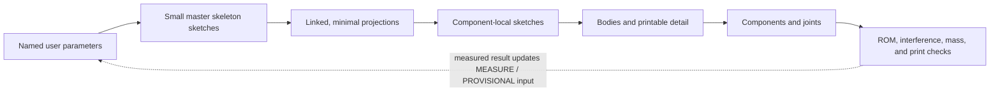

<!-- DRAFT: chapters 0–4 for the consolidated MIST Fusion guide. -->
<!-- UI and Autodesk terminology verified against Fusion v2704.1.23 on 2026-07-12. -->

# 0. Start with the right truth, file type, and coordinate system

This guide builds the current MIST v1: a wheeled quadruped with a cylindrical body, four three-axis legs, and one driven wheel per leg. The outcome of these opening chapters is not a pretty shell. It is a clean Fusion file whose dimensions, coordinate system, component ownership, and dependency direction are correct before expensive detail is added.

Do not begin by tracing the generated panels. Begin by creating the design, entering the parameter table in §4, and drawing the three skeleton sketches. Every later body and joint is driven from that foundation.

## 0.1 Version scope: Autodesk Fusion v2704.1.23

This guide was checked against **Autodesk Fusion v2704.1.23**, released **9 July 2026**, and against Autodesk Help as available on **12 July 2026**. Autodesk now calls the product **Autodesk Fusion**; older tutorials and the AI panels still say “Fusion 360.” They refer to the same product.

Check your installed version from **Help > About**. A later build may move or collapse a command, especially when the application window is narrow. If a named command is not visible:

1. Press `S` to open the Toolbox and search for the exact command name.
2. Expand the relevant toolbar panel; Fusion collapses buttons into menus responsively.
3. Confirm that the design is a **Hybrid Design**, not a Part or Assembly Design.
4. Confirm that the file is in **Parametric Modeling Mode**.

The July 2026 release introduced a refreshed Home/My Fusion page, reorderable document tabs, a resizable ViewCube, and clearer sketch colours. It did **not** replace the Browser, Timeline, Change Parameters, Project, or component workflows used here. The larger workflow break happened in January 2026, when Fusion introduced Part, Assembly, and Hybrid design types. [Autodesk July 2026 release notes](https://www.autodesk.com/products/fusion-360/blog/july-2026-major-product-update-whats-new/)

## 0.2 What is authoritative

Different sources answer different questions. Use this order instead of choosing whichever number appears in the nicest picture.

| Question | Authority | What to do when sources disagree |
|---|---|---|
| MIST architecture, axes, joint chain, nominal link lengths, body size, leg azimuths, and ROM | `docs/mist/MIST_FUSION_MASTER_DIMENSIONS.md`, backed by `docs/mist/MIST_ACTUATOR_LAYOUT_STUDY.md` and `sim/js/kin.js` | Use the 12 July 2026 master value. A change is a redesign and must also be propagated to the simulator, assembly, and documentation. |
| Servo, horn, battery, phone, board, connector, and cable interfaces | The exact physical item measured with calipers, then a material-matched print coupon | Replace only the matching **MEASURE** placeholder. Record the measured item, method, date, and coupon result. A listing or AI dimension never outranks the part in your hand. |
| Fit, printer compensation, shell thickness, fillets, wall sizes, and service clearances | Coupon result and interference/range testing | Treat the table value as **PROVISIONAL**. Tune it deliberately and keep its clearance semantics unchanged. |
| Fusion commands and current UI terminology | Current Autodesk Help and the live v2704.1.23 application | Prefer current labels. Older “Capture Design History” instructions mean the current “Change to Parametric Modeling Mode.” |
| Shape, colour, personality, and broad visual proportions | The generated images in `mist_3d/mist_fusion_guide/` | Use as mood boards only. Crop away dimensions, fake dialogs, and inaccurate mechanisms. |

The parameter table uses four tags:

- **LOCKED** — the approved MIST v1 baseline. Do not casually “tune” it in CAD.
- **MEASURE** — a usable nominal placeholder that must be replaced by a real measurement before a final mating part is printed.
- **PROVISIONAL** — an explicit starting design choice that must pass a coupon, print, access, or interference test.
- **DERIVED** — a formula. Change its inputs, not the result.

“Locked” does not mean Fusion prevents editing. It is a project change-control rule recorded in the parameter comment. Fusion has no native lock state for a user parameter.

## 0.3 What the generated panels get wrong

The six panels are useful for orientation and visual intent, but they are internally consistent illustrations of a different robot. In particular:

- `c9f98018-dc76-4914-9e09-42f10d75449e.png` says body diameter `220 mm`; MIST v1 is **`180 mm`**.
- Several panels show four legs at equal `90°` intervals; MIST uses front azimuths **`+25°/-25°`** and rear azimuths **`+109°/-109°`** from +X.
- `2ee53a2c-b6a6-414f-bd26-0ddb6c07c57e.png` shows a two-link leg with a passive foot pad and `90/70 mm` links. MIST has hip roll, hip pitch, knee, and a driven wheel; its centre distances are **`d1=32`, `femur=110`, `tibia=70 mm`**, where tibia ends at the **wheel axle**, not the ground.
- `d9363efa-0ea2-4767-89ec-a16e4b8b0fc9.png` suggests generic hip/knee limits. MIST’s simulated joint limits are roll `-60°…+60°`, hip `-35°…+110°`, knee `-135°…+135°`.
- The illustrated `100 × 70 mm` landscape screen is not the final phone envelope. The Xiaomi Mi 9 SE is nominally `147.5 × 70.5 × 7.45 mm` and is mounted in **portrait** orientation.
- AI-rendered Fusion icons and dialogs are not screenshots. Never use them to decide which checkbox or Operation to select.

> **Figure brief — safe reuse of the AI art:** crop only the central robot render from `c9f98018-dc76-4914-9e09-42f10d75449e.png` (approximately x=385–815, y=90–625 in the 1448×1086 source). Caption it “visual concept — not to scale.” Do not include its parameter table, 220 mm calibration instruction, fake UI icons, or dimensioned blockout views.

## 0.4 Choose Hybrid Design, not the tempting defaults

As of 2026, **design type** controls which structure and tools Fusion exposes.

| Design type | Best at | Cost for this guide | Verdict |
|---|---|---|---|
| **Part Design** | One focused, reusable part file | Cannot contain the complete internal multi-component robot; assembly commands are intentionally hidden | Excellent later for reusable production parts, wrong for the beginner master file |
| **Assembly Design** | Combining externally saved parts and subassemblies with relationships | Part-modeling tools are hidden by default; every part normally becomes another managed file | Best scalable/professional split-file architecture, but too much file/reference overhead for the first pass |
| **Hybrid Design** | Top-down concept modeling with internal components plus assembly tools in one file | Fusion allows messy structure unless you enforce it | **Use for this guide** |

Create it exactly as follows:

1. **File > New…**
2. Select **Hybrid Design**.
3. Click **Create New**.
4. Immediately press `Ctrl+S` and save it as `MIST_v1_master` in a dedicated project folder.

> **Fresh screenshot brief:** capture the v2704.1.23 **File > New…** chooser with Part, Assembly, and Hybrid visible; crop tightly around the dialog and highlight Hybrid. Do not substitute the AI Step 1 panel, which predates Intent-Driven Design and invents its controls.

If you already created the wrong type:

1. In the Browser, expand **Document Settings**.
2. Hover over **Design Type** and click the pencil icon.
3. Choose **Hybrid Design** and click **OK**.

Fusion can convert a Part Design to Hybrid at any time. It cannot convert a populated multi-component Hybrid/Assembly design back to a single Part Design without first removing child components. [Autodesk design-type conversion](https://help.autodesk.com/view/NINVFUS/ENU/?guid=ASM-CONVERT-DESIGN-TYPE)

### Why not start with separate Part and Assembly files?

That is a strong long-term architecture: a small skeleton design can be derived into separate Part Designs, which are inserted into an Assembly Design. It gives cleaner reuse, collaboration, BOMs, and per-part timelines. It also creates external links, update states, file naming, and Edit In Place decisions before a beginner has learned what a component is. The one-file Hybrid workflow keeps those failure modes out of the first build. §3.8 explains when to graduate.

## 0.5 Use Parametric Modeling Mode

**Design type** and **modeling mode** are independent:

- Hybrid/Part/Assembly decides which tools and component structures are available.
- Parametric/Direct decides whether Fusion captures editable features, relationships, and parameters in the Timeline.

Set the default for new files:

1. Click your avatar in the upper-right.
2. **Preferences > Design > Default Modeling Mode**.
3. Select **Parametric Modeling Mode**.
4. Click **OK**.

For the current file, if there is no Timeline:

1. Right-click the top/default component in the Browser.
2. Click **Change to Parametric Modeling Mode**.

Older tutorials call this **Capture Design History**. Do not switch an established MIST file to Direct mode just to make one awkward edit. The current command **Change to Direct Modeling Mode** opens a **Delete Parametric History** confirmation and dissolves the editable feature history. Switching back wraps prior direct geometry in one Base Feature; it does not reconstruct the deleted Timeline. For contained edits to imported geometry, use **Solid > Create > Create Base Feature** inside the otherwise parametric design. [Autodesk modeling modes](https://help.autodesk.com/cloudhelp/ENU/Fusion-Designs/files/ASM-DESIGN-MODELING-MODES.htm)

## 0.6 Set millimetres and the robot frame before drawing

MIST uses the same right-handed frame in Fusion, the simulator, and the eventual URDF:

| Axis | Positive direction | Visual meaning |
|---|---|---|
| `+X` | Forward | Toward the phone/front face |
| `+Y` | Left | Robot’s left when looking forward |
| `+Z` | Up | Away from the ground |

Before creating the design, set **Avatar > Preferences > General > Default modeling orientation > Z up**. Z up is the current documented default, but set it explicitly; if you changed it, restart Fusion before creating the file. This preference is most reliable for new designs. In the new file:

1. Expand **Document Settings** in the Browser.
2. Hover **Units**, click the edit icon, and set active units to **Millimeter**.
3. Orbit to a top view and verify that the XY plane is horizontal and +Z points up.
4. Treat the global origin as the **body axis at the cylinder bottom plane**. Do not move it to a convenient face later.

Changing display units does not repair a model that was designed with the wrong scale. A value entered as bare `180` inherits the current context; the table deliberately uses explicit `180 mm` and `25 deg` expressions.

## 0.7 Chapter 0 gate

Do not continue until all are true:

- About shows Fusion v2704.1.23 or a documented later build.
- The file is a saved **Hybrid Design**.
- The Timeline is visible and the file is in **Parametric Modeling Mode**.
- Document units are millimetres.
- The model uses +X forward, +Y left, +Z up.
- You can state why the AI panel’s Ø220 body and 90° leg pattern are not dimensions.

# 1. Fusion UI primer: the few regions that control everything

Fusion’s interface is easier once two similarly placed trees are not confused: the **Data Panel** contains cloud files; the **Browser** contains objects inside the open file.

## 1.1 Interface map

| Region | Where | What it controls | Beginner trap |
|---|---|---|---|
| **Application Bar** | Across the very top | File, Save, Undo/Redo, notifications, Help, profile/preferences | “Home” is not the in-design Browser. |
| **Home / My Fusion** | Home icon at upper-left | Recent designs, projects, search, creation shortcuts | July 2026 merged the old Recent page into My Fusion; older screenshots differ. |
| **Data Panel** | Panel toggled near upper-left | Hubs, projects, folders, designs, versions | Renaming a Browser component does not rename a cloud design file. |
| **Document tabs** | Below the Application Bar | Switch between open designs | Tabs can be dragged into a new order in v2704.1.23. Confirm which file is active before editing. |
| **Workspace menu** | Upper-left of the design toolbar | Design, Render, Animation, Simulation, Manufacture, Drawing | This guide stays in **Design** until an explicit validation/export step. |
| **Toolbar tabs and panels** | Top of the canvas | Solid, Surface, Mesh, Sheet Metal, Plastic, Assemble, Construct, Inspect, Insert, Select | Visible tabs depend on design type; narrow windows collapse buttons into panel menus. |
| **Browser** | Left of the canvas | Components, origins, sketches, bodies, construction, joints, visibility, activation | The bulb changes visibility; the radio circle changes the active modeling context. They are not interchangeable. |
| **Canvas** | Centre | Geometry, selections, manipulators, previews | Preview geometry is not committed until the dialog is accepted. |
| **ViewCube** | Upper-right of canvas | Standard views and orbit reference | Right-click it in July 2026 to resize it. Use named faces instead of trusting a visually “almost front” view. |
| **Navigation Bar** | Bottom-centre of canvas | Orbit, pan, zoom, display settings, grid, visual style | Perspective can make parallel geometry look skewed. Use orthographic standard views for layout checks. |
| **Timeline** | Bottom | Ordered parametric history and assembly relationships | Moving the marker back is a temporary rollback; return it to the far right before continuing. |
| **Command dialog** | Usually right side | Selection sets, extents, direction, operation, preview, OK/Cancel | `Operation: Join` can accidentally fuse geometry that should move separately. Read it every time. |
| **Sketch Palette** | Right side while editing a sketch | Construction/centreline, grid/snap, slice, profile, dimensions, constraints, projection display | It appears only in the Sketch contextual environment. |

Autodesk’s current names for these regions are documented in [The Fusion interface](https://help.autodesk.com/cloudhelp/ENU/Fusion-GetStarted/files/GS-THE-FUSION-INTERFACE.htm).

> **Fresh screenshot brief:** capture a clean Hybrid Design workspace at 1440 px or wider. Annotate Data Panel, Browser, Toolbar, Canvas, ViewCube, Navigation Bar, and Timeline. Include a short inset that contrasts “Data Panel = files” with “Browser = objects in this file.”

## 1.2 Selection and navigation habits

- **Single click** selects. `Ctrl`+click adds/removes items from a selection set.
- **Right-click** opens the context menu and marking menu. Context commands depend on the current selection and active environment.
- `Esc` cancels the current tool or clears a selection layer. Press it before assuming Fusion is ignoring a click.
- `S` opens the searchable Toolbox. This is the safest route when a toolbar button moved or collapsed.
- `Ctrl+S` saves; `Ctrl+Z` undoes; `Ctrl+B` runs **Compute All**.
- While editing a sketch, `D` starts **Sketch Dimension** and `P` starts **Project**.
- Use the ViewCube’s **Top**, **Front**, and **Right** faces for checks. Use **Look At** in the Sketch Palette to face an active sketch directly.
- Middle-mouse drag pans; `Shift`+middle-mouse drag orbits; the mouse wheel zooms in the default navigation mapping. If preferences changed those controls, use the Navigation Bar icons rather than fighting muscle memory.

Selection filters matter in a crowded assembly. If Fusion keeps selecting faces when you need a component, use **Select > Selection Priority > Component Priority**, make the selection, then restore normal selection. Do not hide half the Browser as a substitute for understanding ownership.

## 1.3 Read the Browser before every sketch or feature

The Browser is a live answer to three questions:

1. **Where will new geometry be owned?** The component with the filled activation radio is active.
2. **What can I see?** The bulb controls visibility only.
3. **What kind of object is this?** Component, body, sketch, origin, construction, and joint icons are different.

When an internal component is activated, sibling components normally become translucent and the Timeline filters to that component’s relevant history. Click the radio beside the top/default component to return to the full assembly context.

Name objects as soon as they are created. `Sketch1`, `Body7`, and `Component12` become impossible to reason about after a few hours. Use the naming scheme in §2.4.

## 1.4 Read the Timeline as cause → effect

The Timeline runs left to right. A sketch must exist before the Extrude that consumes it; a base shape normally exists before its fillet; a component must exist before its joints.

Useful actions:

- Double-click or right-click a feature and choose **Edit Feature** instead of piling a corrective feature at the end.
- Rename important sketches/features from their Browser or Timeline context menus.
- Drag the Timeline marker left to inspect an earlier state. Return it to the far right before creating new features unless a deliberate rollback edit is intended.
- Use Timeline groups to separate `00_LAYOUT`, `10_BODY`, `20_INTERFACES`, `30_LIGHTENING`, and `90_FINISH` stages once the file grows.
- Treat a yellow warning as work, not decoration. Repair a missing projection or reference before adding downstream features.
- Stop on a red error. Deleting the red feature often transfers the failure to everything that depended on it.

Suppressing a feature is not the same as hiding it: suppression removes its effect from the computed model and can suppress dependent features. A Browser bulb only changes display.

## 1.5 Sketch colours communicate state, not authority

July 2026 improved contrast in several visual environments, so exact hues vary. Learn the state and behaviour:

| Appearance/state | Meaning | Action |
|---|---|---|
| Ordinary under-constrained geometry, commonly blue | Some size or position freedom remains | Drag-test it; add the missing datum, dimension, or geometric constraint. |
| Fully constrained geometry, commonly black | Size and position are defined | This is the target for master and manufacturing sketches. |
| Projected geometry, commonly purple | Reference imported from another sketch/body/edge | Edit the source if Projection Link is on; do not redraw over it. |
| Fixed geometry, commonly green | Fix/UnFix locked its current position | Avoid as a normal design-intent shortcut; use constraints to explain why it belongs there. |
| Orange/yellow projection with a warning | Source reference is lost | Right-click the sketch in the Timeline > **Manage Lost Projections**. |

A fully constrained sketch also receives a lock indicator in the Browser. “Looks centred” is not a constraint. A circle with a diameter but a floating centre is still under-constrained.

## 1.6 The five fields to read in every solid command

Before clicking **OK** on Extrude, Revolve, Hole, Pattern, or similar commands, read:

1. **Profile/Object** — did Fusion select the intended closed region or body?
2. **Start** — profile plane, offset, object, or other reference?
3. **Extent/Distance** — is it a named parameter, a face reference, or an accidental drag value?
4. **Direction** — one side, two sides, or symmetric?
5. **Operation** — New Body, Join, Cut, Intersect, or New Component?

For a moving MIST link, the usual safe sequence is: pre-create and activate its component, sketch locally, then use **New Body** for the first solid. `Join` is correct only when the new volume is intentionally fused to an existing body in that same rigid component.

## 1.7 UI orientation gate

With `MIST_v1_master` open, prove that you can:

- distinguish the Data Panel from the Browser;
- activate the default component and identify the filled radio;
- expand Document Settings and verify millimetres and Hybrid Design;
- open **Design > Solid > Modify > Change Parameters**, then cancel;
- start a sketch on the XY origin plane, locate the Sketch Palette, then cancel without leaving a stray sketch;
- move the Timeline marker left and return it to the end;
- use `S` to find **Compute All**.

# 2. Components versus bodies: structure the robot before geometry

The shortest reliable rule is:

> **A body is shape. A component is a part or subassembly with identity. If two things must move relative to one another, they must be in separate components.**

## 2.1 Exact distinction

| | Body | Component |
|---|---|---|
| What it is | One contiguous 3D region inside a component | A container for origins, coordinate system, sketches, construction geometry, bodies, joint origins, properties, and child components |
| Can contain | Solid/surface/mesh shape only | One or more bodies plus design/assembly objects |
| Independent motion/joints | No. Bodies inside one component are rigid with respect to one another | Yes. Joints and assembly relationships act on component occurrences |
| Reuse | A copied body is independent geometry | A copied component can create linked occurrences whose definition updates together |
| Drawings/BOM identity | Bodies do not appear as independent parts | Components carry part identity and can appear in drawings/BOMs |
| MIST example | Barrel shell, chassis plate, and fixed boss bodies inside `base_link` | `base_link`, each hip-roll link, femur, tibia, and wheel |

Autodesk explicitly recommends **create component → activate component → create geometry**. Converting bodies after the fact moves the bodies but leaves their original sketches and feature history behind, so the Timeline stays difficult to understand. [Autodesk Bodies](https://help.autodesk.com/cloudhelp/ENU/Fusion-Assemble/files/GUID-C1AB4941-D7AD-4D27-A035-2FA9208635B6.htm) and [Components](https://help.autodesk.com/cloudhelp/ENU/Fusion-Assemble/files/ASM-COMPONENTS.htm)

## 2.2 MIST’s rigid-link rule

Create one component per independently moving rigid link:

- `base_link` — chassis plate, barrel, dome/lid structure, fixed electronics placeholders, and fixed mounting details;
- `{FL,FR,RL,RR}_hiproll` — the rigid link between the hip-roll output and the hip-pitch axis, including the `d1` offset structure;
- `{FL,FR,RL,RR}_femur` — femur beam and anything rigidly attached to it;
- `{FL,FR,RL,RR}_tibia` — tibia beam and wheel carrier;
- `{FL,FR,RL,RR}_wheel` — hub and tire as the rotating wheel link.

The servo **case** belongs to whichever rigid link carries the case; the servo **output horn** belongs to the link driven by that output. Do not group a servo case and its rotating horn into one component just because they arrive in one product box.

Multiple printable bodies may live inside one rigid component. For example, the barrel, deck, and a fixed internal brace can be separate bodies for printing yet still belong to `base_link`. Conversely, a removable service lid may deserve its own component if you need separate BOM/drawing identity or want to animate removal. The test is identity and motion, not “was it printed in one piece?”

## 2.3 Create an internal component in the current UI

For this one-file Hybrid guide:

1. Activate the intended **parent** component in the Browser.
2. **Design > Solid > Assemble > New Component**.
3. Choose a standard Part component.
4. **Uncheck External**. An external component is a separately saved design with a managed reference; that is not wanted yet.
5. Enter the component name.
6. Confirm **Parent**. Fusion often defaults it to whichever component is active.
7. Check **Activate**.
8. Click **OK**.

The exact toolbar path differs in an Assembly Design because its toolbar is assembly-focused. If **New Component** or the **External** option is missing, first check the design type rather than assuming the feature was removed. [Current New Component reference](https://help.autodesk.com/cloudhelp/ENU/Fusion-Assemble/files/GUID-6670497A-3D7B-402F-AD83-AA2B60D22578.htm)

Avoid creating important reusable parts from an Extrude dialog’s `Operation: New Component`. Pre-creating and activating the component makes sketch, feature, and body ownership explicit.

## 2.4 Recommended Browser structure

Create this structure before modeling detailed solids:

```text
MIST_v1_master                         ← default/root component
├── 00_MASTER_LAYOUT                  ← sketches and construction only
├── base_link                         ← fixed body/chassis system
├── Leg_Module:1                      ← occurrence mapped to FL
│   ├── root_mount                    ← rigidly attached to base_link at the explicit mount origin
│   ├── hiproll_link
│   ├── femur_link
│   ├── tibia_link
│   └── wheel_link
├── Leg_Module:2                      ← occurrence mapped to FR
├── Leg_Module:3                      ← occurrence mapped to RL
└── Leg_Module:4                      ← occurrence mapped to RR
```

The one-file baseline validates one neutral `Leg_Module`, then creates three
associative occurrences with **Duplicate With Joints**. A safety-critical rib,
pocket, cable relief, or fillet added to the module definition then reaches all
four legs. Keep a small occurrence map—`:1=FL`, `:2=FR`, `:3=RL`, `:4=RR`—for
joint names, drawings, wiring labels, and export. Only use **Paste New** in a
frozen branch when a measured physical difference truly requires an independent
part definition. A Browser folder/hierarchy expresses ownership; it does not
create motion or make a child follow a parent. That requires a joint, rigid
relationship, or Ground To Parent as appropriate.

Use prefixes that sort naturally:

- sketches: `SK00_TOP_MOUNTS`, `SK01_SIDE_KINEMATICS`, `SK02_FRONT_ENVELOPES`;
- construction: `PL_` for planes, `AX_` for axes, `PT_` for points;
- bodies: `B_` plus purpose, for example `B_barrel_shell`;
- joints: `{leg}_q1_roll`, `{leg}_q2_hip`, `{leg}_q3_knee`, `{leg}_wheel`.

> **Figure brief — components, not dimensions:** the “GOOD PRACTICE” strip at the bottom-left of `23794522-88e1-4b32-8522-f36c110bb668.png` can be cropped as a small conceptual callout showing separate parts. Do not reproduce its screen/chassis dimensions or claim the pictured pieces are the authoritative MIST component tree.

## 2.5 Activate before drawing: the six-second check

Before every **Create Sketch**, glance left:

1. Is the correct component’s radio filled?
2. Is the expected parent highlighted/active?
3. After creating the sketch, did it appear under that component’s **Sketches** folder?

If it appeared under the default component or a sibling, undo immediately, activate the correct component, and create it again. Moving a sketch later can break references or leave feature ownership split across timelines.

Press `Shift+N` to toggle **Display Component Colors**. Different component colours make accidental cross-component bodies visible. Turn it off for aesthetic screenshots, not for structural debugging.

## 2.6 New Body, Join, Cut, and Intersect are design decisions

| Operation | Use when | Typical MIST example | Failure if chosen accidentally |
|---|---|---|---|
| **New Body** | Creating the first solid or a deliberately separate printable/fixed solid in the active component | First barrel shell blank; separate fixed brace body | Harmless extra body if intentional, confusing body count if not |
| **Join** | New volume must become one contiguous solid with a body in the same rigid component | Add a boss to a bracket | Fuses geometry that was meant to move or export separately |
| **Cut** | Removing material from selected target bodies | Servo pocket, cable slot, phone opening | Cuts every visible/intersecting target if Objects To Cut is not checked |
| **Intersect** | Keeping only common volume | Special fixture/trim operation | Deletes most of a part when selected by habit |
| **New Component** | Rarely, quick one-off geometry | Not the baseline workflow | Can obscure which component owns the source sketch and history |

When a Cut preview affects the wrong body, expand **Objects To Cut** and explicitly select the target. Visibility alone is not a robust target-selection method.

## 2.7 Copy semantics: four similar legs without four silent mistakes

| Action | Result | Use |
|---|---|---|
| Copy a **body** | Independent body geometry | One-off manufacturing geometry; not a reusable articulated leg |
| Copy component + **Paste** | Another occurrence of the same component definition; definition edits propagate | Repeated identical parts/modules |
| Copy component + **Paste New** | Independent component definition | A genuinely different variant that must stop following the source |
| **Duplicate With Joints** | Duplicates associative component geometry and creates independently editable joint relationships | Repeating a validated articulated leg module |

Use one handed-neutral leg design wherever possible. The top-layout azimuth and assembly position create FL/FR/RL/RR; do not mirror geometry unless a real cable exit or fastener access forces a handed part.

There are two honest reuse strategies, with the associative one as the project
baseline:

- **Associative module baseline:** keep one `Leg_Module` definition and create
  four linked occurrences with **Duplicate With Joints**. All definition edits
  propagate, while each duplicated joint relationship can be positioned and
  limited independently. Browser names remain occurrence names such as
  `Leg_Module:1`…`:4`; maintain an explicit occurrence-to-FL/FR/RL/RR map
  instead of pretending the shared child definitions have unique names.
- **Independent variant exception:** after the common module and interfaces are
  frozen, copy it with **Paste New** only when a real cable exit, fastener
  access, sensor, or manufacturing constraint forces a handed variant. Record
  the fork and repeat every later common safety fix in each independent
  definition. This is appropriate for a release snapshot, not the default
  development model.

Do not combine the strategies accidentally. A linked edit changing every occurrence is correct when the definition is common; an independent Paste New is correct only when naming/variation justifies losing definition-level associativity.

## 2.8 Common structural failures and repair

| Symptom | Likely cause | Repair |
|---|---|---|
| New sketches/bodies appear at root | Wrong component active | Undo; activate intended component; recreate. |
| Joint cannot select two “parts” independently | They are bodies inside one component | Create proper components and rebuild ownership before adding more dependencies. |
| **Create Components from Bodies** appears to fix the tree but Timeline remains mixed | Command moved bodies, not their creation history | Accept only as a limited rescue; for an early model, rebuild cleanly in pre-created components. |
| Editing one repeated leg unexpectedly changes all | It is a linked occurrence | Keep if geometry should be identical; use Paste New/variant only for intentional divergence. |
| Editing one leg does not update the others | A body was copied or Paste New was used | Replace with linked component occurrences or drive all variants from the same parameters/derived source. |
| Child component does not follow its parent | Browser nesting was mistaken for a relationship | Add the correct joint, rigid relationship, or Ground To Parent. |
| First inserted external component will not move | Fusion commonly grounds the first inserted component | Inspect its ground state and unground only if another base is intended. |
| Timeline vanished | File changed to Direct Modeling Mode | Undo immediately or restore a saved version; changing back cannot reconstruct deleted history. |
| Move/Copy leaves a link visually in place but logically confusing | Bodies were moved for assembly positioning | Position components with joints/relationships; model bodies in their permanent local component coordinates. |

## 2.9 Component-structure gate

Before detailed modeling:

- `00_MASTER_LAYOUT` and `base_link` exist as internal components.
- The intended one-component-per-rigid-link structure is documented in the Browser.
- Activating a component filters the Timeline and makes siblings translucent.
- `Shift+N` shows different component ownership clearly.
- No articulated pair exists as two bodies inside one component.
- The default/root component contains assembly-level relationships, not accidental production bodies.

# 3. Parametric workflow: make every important change have one owner

A parametric model is not merely a model that contains dimensions. It is a model in which each important decision has one stable input, downstream geometry references that input, and Fusion can recompute the result without losing the intended shape or ownership.

For MIST, the dependency direction is:



Never create an arrow back from a child component into the skeleton that drives it. Circular or sideways dependencies are the fastest route to a Timeline that only works at one exact set of dimensions.

## 3.1 The build order

Use this order even when a later feature looks more interesting:

1. **State the decision.** Example: body outer diameter is 180 mm; hip-roll axis radius is body radius plus a 10 mm standoff.
2. **Create or reuse one named User Parameter.** Do not type the same literal into several dialogs.
3. **Express layout in a small skeleton sketch.** Axes, pivot centres, ground, envelopes, and symmetry only.
4. **Create and activate the owning component.** Its local origin and Browser identity exist before geometry.
5. **Project only the necessary skeleton points/lines.** Keep Projection Link on when the child is supposed to follow.
6. **Draw a fully constrained local sketch.** Manufacturing shape belongs here: wall, boss, pocket, rib, slot, and print detail.
7. **Create simple primary solids.** New Body first; joins/cuts deliberately.
8. **Add interfaces.** Servo pockets, horn recesses, fasteners, cable paths, and wheel interfaces.
9. **Add lightening and finish features late.** Fillets and chamfers are poor upstream datums.
10. **Assemble and validate.** Joints, ROM sweeps, interference, mass, print orientation, and coupon gates.

This order costs a few minutes before the first Extrude and saves hours when a measured servo ear differs from a listing.

## 3.2 User Parameters versus Model Parameters

Fusion currently has two native parameter types:

- **User Parameters** are deliberate design inputs/formulas created in the Parameters dialog. The table in §4 uses these.
- **Model Parameters** are dimensions and values attached to sketches and Timeline features. Fusion creates them automatically; their generated names often look like `d17`.

“Global parameter” is sometimes used informally for a shared master-file workflow, but it is not a third native row type in the Parameters dialog.

Create the MIST inputs with **Design > Solid > Modify > Change Parameters > + User Parameter**. In the **Expression** field enter `body_dia/2`, not `=body_dia/2`.

When editing a sketch or feature value field:

- type an existing User Parameter name, such as `beam_t`;
- or deliberately name a Model Parameter inline with syntax such as `barrel_height=body_h`.

Inline `name=expression` creates/names a **Model Parameter** and favorites it. Do not use the leading `name=` syntax in a User Parameter’s Expression cell.

Use User Parameters for design decisions shared by several features. Use named Model Parameters for a feature-specific value worth finding again. Leave incidental values such as a one-off 360° revolve angle with generated names unless naming improves clarity.

## 3.3 Parameter naming and comments

Use lowercase `snake_case`, start with a letter, and keep one meaning per name. This guide treats names as case-sensitive even where a particular field may be forgiving.

Good:

```text
body_dia
mount_r
pocket_clearance_per_side
servo_axis_from_end
```

Bad:

```text
D                 (meaning is invisible)
clearance         (radial, diametral, per face, motion, or printer correction?)
servoSize         (which axis?)
new_body_2        (history, not intent)
```

Start each Comments cell with its change class and then record semantics, source, and consequence:

```text
[LOCKED] Barrel outer diameter; MIST master 2026-07-12; changing also moves mount_r.
[MEASURE] Nominal listing value; replace from physical C018 servo and date the measurement.
[PROVISIONAL] Gap per mating face, not total; tune with PETG pocket coupon.
[DERIVED] Do not edit; formula from body_dia and mount_standoff.
```

Click the star to favorite primary inputs that you actually expect to inspect. Do not favorite every derived coordinate; autocomplete and the Favorites filter become noisy.

## 3.4 Units and expression syntax

Enter explicit units in every literal:

```text
180 mm
25 deg
0.25 mm
```

Fusion converts compatible units, but the expression’s resulting dimensional type must match the parameter’s selected Unit. A length divided by a length is unitless; a length plus an angle is invalid.

Useful Design-expression examples:

```text
body_dia / 2
body_dia - 2 * shell_wall
mount_r * cos(front_az)
if(shell_wall < 3 mm; 3 mm; shell_wall)
max(2.4 mm; m3_clear_model_d)
```

Current Design expressions use semicolons between multi-argument function arguments, not commas. Equality is `==`; not-equal is `<>`. Manufacture expressions use a different engine, so do not copy `Math.*`, `!=`, or JavaScript ternary syntax from a CAM tutorial into Change Parameters. [Autodesk Design parameter reference](https://help.autodesk.com/cloudhelp/ENU/Fusion-Model/files/GUID-76272551-3275-46C4-AE4D-10D58B408C20.htm)

For roots or powers of dimensional values, normalize to a unitless number and restore the unit if Fusion rejects the dimensional expression, for example:

```text
sqrt((dx/1 mm)^2 + (dz/1 mm)^2) * 1 mm
```

## 3.5 Automatic Update, Apply, and Compute All

Automatic Update is on by default in the Parameters dialog. It is ideal while this file is small because the canvas immediately exposes a bad expression or flipped sketch.

As the assembly grows:

1. Save a version.
2. Open Change Parameters.
3. Turn off **Automatic Update** for a related batch of edits.
4. Change only the intended rows.
5. Commit/recompute using the dialog’s current **Apply/OK** behaviour.
6. Close the dialog and run **Modify > Compute All** or `Ctrl+B`.
7. Resolve every yellow warning and red error before continuing.

Autodesk’s current Help is internally inconsistent about exactly when the Apply button is enabled, so this guide does not rely on that state. The invariant is: do not trust a canvas that has not recomputed after an upstream edit.

## 3.6 Stable references versus fragile references

Prefer these, in order:

1. global/component origins and origin planes;
2. named construction planes, axes, and points;
3. skeleton sketch points and construction lines;
4. simple primary sketch geometry;
5. generated body faces and edges only when they are genuinely stable.

Avoid using these as upstream datums:

- the edge created by a fillet or chamfer;
- an arbitrary face that may disappear when a shell or combine changes;
- a patterned instance edge;
- “the third edge from the left” of an imported body;
- a silhouette that changes topology as a parameter crosses a threshold.

Sketch on an origin or explicit construction plane when possible. A sketch attached to a convenient solid face can lose its plane when that face is rebuilt. Put cosmetic fillets/chamfers near the right end of the Timeline so earlier interface features do not depend on their edges.

## 3.7 Safe change protocol

For every significant parameter change:

1. **Classify it.** LOCKED requires a redesign decision; MEASURE requires evidence; PROVISIONAL requires a test result; DERIVED should not be edited.
2. **Save a named version** describing the state before change.
3. **Change one conceptual group**, not ten unrelated rows. Example: update all three measured phone dimensions together, but do not also change leg length.
4. **Compute All.** Stop on errors.
5. **Inspect skeleton sketches.** Look for branch flips, lost symmetry, and blue geometry.
6. **Inspect feature previews and body count.** A changed profile can make an Extrude select a different region.
7. **Drive joints through ROM** and run interference checks where geometry or clearance changed.
8. **Recheck mass/CoM and print envelope** where size/material volume changed.
9. **Print the required coupon** before a final mating or load-bearing part.
10. **Record the result** in the parameter comment and the build log.

Changing a number until the red Timeline icon disappears is not validation. The result must still express the intended mechanism.

## 3.8 One-file Hybrid versus master + Derive

The guide baseline keeps parameters and skeletons in `MIST_v1_master`. When the design becomes stable or more than one person edits parts, split it deliberately:

| Workflow | Strength | Cost | Use when |
|---|---|---|---|
| One Hybrid file, internal components | Easiest visibility and updates; no external reference management | Large Timeline; accidental cross-component dependencies are easy | First full beginner build |
| Separate skeleton design + **Insert Derive** into Part Designs | Explicit shared source for selected sketches, construction, and favorite parameters | Associative file links must be updated and cannot be casually moved between storage contexts | Reusable production parts and controlled variants |
| External Part Designs in an Assembly Design | Clean part identity, collaboration, per-part history, BOM, performance | Most files, versions, and Edit In Place decisions | Mature project/team workflow |

To share a curated parameter set later:

1. Favorite only the intended parameters in the master design and save it.
2. In the destination Part Design, activate the owning component.
3. **Design > Solid > Insert > Insert Derive**.
4. Select the master design.
5. Under Parameters, select **Favorites** and choose only the needed sketches/construction.
6. Keep the link so source changes can propagate; derived parameter names receive an `_Ref` suffix.

Use Derive for a clear, reusable source of truth. Use Edit In Place when an external part intentionally depends on its placed assembly context. Never create a two-way chain in which the skeleton derives a component that also derives the skeleton.

## 3.9 Parametric-workflow gate

- The file is still in Parametric Modeling Mode.
- Primary decisions are User Parameters, not repeated literals.
- Every parameter comment begins with LOCKED, MEASURE, PROVISIONAL, or DERIVED.
- Master sketches reference origins/parameters and are fully constrained.
- Downstream components project from the skeleton; the skeleton does not reference them.
- Fillets, chamfers, and decorative detail are not used as upstream datums.
- `Ctrl+B` completes with no yellow warnings or red errors.

# 4. Enter the MIST parameter set and build the master skeleton

This chapter creates the geometric contract used by the rest of the model. Enter rows in the order shown because DERIVED expressions refer to earlier names.

## 4.1 Open the Parameters dialog

1. Activate the top/default component.
2. **Design > Solid > Modify > Change Parameters**.
3. Click **+ User Parameter** for each row.
4. Copy the **Name**, select the stated **Unit**, and enter the **Expression** exactly.
5. Put the leading status tag and source/meaning in **Comments**.
6. Star only the rows marked `Yes` in the Favorite column.

The current dialog contains User and Model Parameter sections plus search, User/Favorite filters, Timeline-order sorting, Automatic Update, and the columns Name, Unit, Expression, Value, and Comments. Value is calculated; never type a second independent number there. [Autodesk Parameters in Fusion](https://help.autodesk.com/cloudhelp/ENU/Fusion-Model/files/SLD-MODIFY-PARAMETERS.htm)

> **Fresh screenshot brief:** capture the full v2704.1.23 Parameters dialog after entering one LOCKED, one MEASURE, one PROVISIONAL, and one DERIVED row. Annotate Add User Parameter, Favorite star, Unit, Expression versus calculated Value, Comments, filters/search, and Automatic Update.

## 4.2 LOCKED architecture, pose, and ROM parameters

These are the approved MIST v1 baseline from `MIST_FUSION_MASTER_DIMENSIONS.md`. Changing one requires a deliberate architecture review and matching updates to the simulator/kinematics documentation.

| Name | Unit | Expression to enter | Favorite | Exact meaning / impact |
|---|---|---:|:---:|---|
| `body_dia` | mm | `180 mm` | Yes | Barrel outside diameter. Not the AI panel’s 220 mm. Changing it also changes body radius and hip-axis radius. |
| `body_h` | mm | `260 mm` | Yes | Cylinder height from bottom plane; excludes dome and handle. Already leaves only 5 mm nominal Z headroom on a 265 mm printer before brim/travel considerations. |
| `leg_mount_h` | mm | `35 mm` | Yes | Hip-roll axis height above the cylinder bottom plane. Not ground clearance. |
| `mount_standoff` | mm | `10 mm` | Yes | Radial gap from shell surface to hip-roll axis. |
| `d1` | mm | `32 mm` | Yes | Hip-roll axis to hip-pitch axis, outward along the radial roll axis. |
| `femur` | mm | `110 mm` | Yes | Hip-pitch axis to knee axis, centre-to-centre. The optimizer returned about 111 mm; 110 is the approved printable value. |
| `tibia` | mm | `70 mm` | Yes | Knee axis to **wheel axle**, centre-to-centre. It does not end at the ground contact. |
| `wheel_dia` | mm | `70 mm` | Yes | Finished tire outside diameter. The old Ø76 coupon is not the CAD baseline. |
| `front_az` | deg | `25 deg` | Yes | Magnitude of front-left/front-right mount azimuth about +Z from +X. Actual mounts are `+front_az` and `-front_az`. |
| `rear_az` | deg | `109 deg` | Yes | Magnitude of rear-left/rear-right mount azimuth about +Z from +X. Actual mounts are `+rear_az` and `-rear_az`. |
| `beam_w` | mm | `20 mm` | Yes | Structural link cross-section width. Define which local direction is width in every part sketch. |
| `beam_t` | mm | `14 mm` | Yes | Structural link cross-section thickness. Bending stiffness depends strongly on which way this dimension is oriented. |
| `stance_r` | mm | `176 mm` | Yes | Reference-pose wheel/ground-contact radius from body axis. Pose check, not a manufactured link length. |
| `neutral_body_clearance` | mm | `148 mm` | Yes | Reference-pose body-bottom height above ground. In the body-local side sketch, ground is at `-neutral_body_clearance`. |
| `tallest_body_clearance` | mm | `171 mm` | No | Historical Layout A upper reference; the rounded 110/70 scan begins around 170 mm. Revalidate as a pose/ROM check rather than treating 171 mm as a guaranteed stand height. |
| `q1_min` | deg | `-60 deg` | No | Hip-roll lower ROM limit. |
| `q1_max` | deg | `60 deg` | No | Hip-roll upper ROM limit. |
| `q2_min` | deg | `-35 deg` | No | Hip-pitch lower ROM limit. |
| `q2_max` | deg | `110 deg` | No | Hip-pitch upper ROM limit. |
| `q3_min` | deg | `-135 deg` | No | Knee lower ROM limit. MIST’s default spider branch uses negative knee bend. |
| `q3_max` | deg | `135 deg` | No | Knee upper ROM limit. |

Use comments such as `[LOCKED] MIST master 2026-07-12 — knee axis to wheel axle, not ground` rather than repeating only the number.

## 4.3 MEASURE parameters: nominal placeholders, not permission to print final fits

These values are sufficient for layout. The servo body envelope and spline/output screw have stronger source support than the ear/horn details, but **all mating geometry must be checked against the exact delivered C018 hardware**. Update each row’s comment with the measured value, tool, part/variant, and date.

| Name | Unit | Expression to enter | Favorite | Nominal meaning and measurement gate |
|---|---|---:|:---:|---|
| `servo_l` | mm | `45.2 mm` | Yes | Servo body length. Measure the maximum case dimension, excluding ears/cable. |
| `servo_w` | mm | `24.7 mm` | Yes | Servo body width. Measure seam/label bulges if they control the pocket. |
| `servo_h` | mm | `35 mm` | Yes | Servo body height excluding horn and cable. |
| `servo_ear_ext` | mm | `5.9 mm` | Yes | Assumed ear projection beyond each body end. Verify both ends; asymmetry matters. |
| `servo_ear_underside_z` | mm | `26.5 mm` | Yes | Assumed body-bottom to ear underside height. Verify the exact datum before an ear-hang bracket. |
| `servo_ear_hole_pitch` | mm | `17 mm` | Yes | Assumed mounting-hole pitch used by the old coupon. Identify and record exactly which two centres this describes before consuming it. |
| `servo_axis_from_end` | mm | `11.3 mm` | Yes | Assumed output-axis centre from the body end datum. This moves every joint axis if wrong. |
| `servo_spline_dia` | mm | `5.9 mm` | Yes | Nominal 25T spline outside diameter. Do not model printable spline teeth from this one number. |
| `servo_spline_teeth` | No Units | `25` | No | Nominal tooth count. Use the metal horn rather than a raw printed spline for structure. |
| `servo_output_screw_d` | mm | `3 mm` | No | Nominal M3 output screw major diameter. Verify supplied screw and thread engagement. |
| `servo_output_screw_l` | mm | `6 mm` | No | Nominal M3×6 output screw length. Verify whether horn thickness changes usable engagement. |
| `horn_dia` | mm | `21 mm` | Yes | Assumed horn outside diameter. Old coupon recess was based on this value. |
| `horn_t` | mm | `3.4 mm` | Yes | Assumed horn thickness. Measure under clamp/washer features as well as the flat disc. |
| `horn_bcd` | mm | `14 mm` | Yes | Placeholder midpoint of the old 12–16 mm slotted test range. **Do not make final round holes until measured.** |
| `phone_h` | mm | `147.5 mm` | Yes | Xiaomi Mi 9 SE nominal portrait height. Measure the actual phone with protector/case choice resolved. |
| `phone_w` | mm | `70.5 mm` | Yes | Phone nominal short dimension; horizontal width in portrait orientation. |
| `phone_t` | mm | `7.45 mm` | Yes | Naked-phone thickness. Case, foam, buttons, camera bump, and USB plug require separate keepouts. |
| `battery_l` | mm | `104 mm` | Yes | Nominal HOOVO pack envelope length. Measure the actual undamaged pack and cable exit; the tray must not compress the pouch. |
| `battery_w` | mm | `34.5 mm` | Yes | Nominal pack width. Add padding and abnormal-pack keep-out separately. |
| `battery_h` | mm | `24.5 mm` | Yes | Nominal physical pack thickness. Do not confuse this with the simulator’s battery mass-centre Z coordinate. |

The first servo measurement gate is stricter than “the body fits”: body, ears, ear holes, output axis, rear support stub, horn recess/holes, connector/cable exit, and tool access must all be represented before a final servo carrier is printed.

## 4.4 PROVISIONAL manufacturing and packaging parameters

These are explicit starting points. They become approved only after the named test. Unlike a MEASURE value, a PROVISIONAL value may remain a design choice after testing.

| Name | Unit | Expression to enter | Favorite | Semantics and test |
|---|---|---:|:---:|---|
| `shell_wall` | mm | `3 mm` | Yes | Starting shell wall. The AI panel also says 3 mm, but that is not evidence; validate stiffness, split strategy, print time, and local reinforcement. |
| `pocket_clearance_per_side` | mm | `0.25 mm` | Yes | Gap on **each mating face** of a rectangular pocket. Pocket size = measured maximum + `2*` this value. Tune with a PETG servo-pocket coupon. |
| `pin_radial_clearance` | mm | `0.25 mm` | Yes | Radial gap around a free printed/metal pin. Hole diameter adds `2*` this value. Tune with the actual material/orientation. |
| `hole_diameter_comp` | mm | `0.20 mm` | Yes | Starting **diameter correction** for FDM hole undersize, not fit clearance. Repo guidance only says holes often shrink 0.2–0.4 mm; replace from the calibration coupon. |
| `motion_clearance` | mm | `2 mm` | Yes | Minimum starting air gap between swept moving envelopes. Separate from manufacturing fit; validate throughout ROM with cables and screw heads present. |
| `min_boss_wall` | mm | `2.4 mm` | Yes | Minimum radial material around a fastener hole before local load analysis; increase at structural pivots. |
| `m3_clear_model_d` | mm | `3.4 mm` | Yes | Starting modeled M3 pass-through diameter, independent of generic pin clearance. Coupon/ream to the chosen fit. |
| `edge_chamfer` | mm | `0.5 mm` | No | Starting bottom-edge elephant-foot relief where appropriate; do not blindly chamfer sealing/mating datums. |
| `cable_slot_w` | mm | `8 mm` | Yes | Starting clear slot width selected from the existing 4/6/8/10 mm coupon family. Validate plug passage, bend, abrasion radius, and print orientation. |
| `phone_clearance_per_side` | mm | `0.5 mm` | Yes | Starting per-side phone pocket clearance; reproduces the old 71.5×148.5 mm naked-phone pocket. Add case/foam separately rather than hiding it here. |
| `phone_frame_wall` | mm | `3 mm` | Yes | Starting frame border outside the pocket in the front-view layout; verify local curvature, stiffness, screw/strap access. |
| `phone_center_z` | mm | `170 mm` | Yes | Provisional centre height above body bottom, consistent with the current mass placeholder. Recheck CoM, dome margin, leg/mount overlap, and camera view. |
| `horn_slot_bcd_min` | mm | `12 mm` | No | Inner limit of the provisional radial horn-hole slots used until the actual bolt circle is measured. |
| `horn_slot_bcd_max` | mm | `16 mm` | No | Outer limit of the provisional horn-hole slots. Replace slots with measured final holes only after coupon proof. |

### Clearance vocabulary is mandatory

The old `fit_clearance = 0.25 mm` name is deprecated because existing documents do not say consistently whether it is per face, radial, or diametral. **Do not create that ambiguous alias in a new file.** Use the explicit parameters above.

If an existing design already uses `fit_clearance`, audit every consuming formula before renaming it:

```text
rectangular pocket = measured_max + 2 * pocket_clearance_per_side
free pin hole      = pin_max + 2 * pin_radial_clearance + hole_diameter_comp
moving keepout     = swept_envelope + motion_clearance
```

Do not use those formulas for threaded holes, heat-set inserts, or an M3 pass-through by habit. Each has a different manufacturing mechanism and coupon.

## 4.5 DERIVED parameters: enter formulas, then leave them alone

| Name | Unit | Expression to enter | Expected nominal Value | Purpose |
|---|---|---|---:|---|
| `body_r` | mm | `body_dia/2` | 90 mm | Barrel outer radius. |
| `body_inner_dia` | mm | `body_dia-2*shell_wall` | 174 mm | Nominal clear diameter before ribs/curvature/service hardware. |
| `mount_r` | mm | `body_r+mount_standoff` | 100 mm | Body axis to hip-roll axis. |
| `hip_pitch_r` | mm | `mount_r+d1` | 132 mm | Body axis to hip-pitch axis in the zero-roll generic leg plane. |
| `wheel_r` | mm | `wheel_dia/2` | 35 mm | Finished wheel radius. |
| `leg_reach_cc` | mm | `femur+tibia` | 180 mm | Maximum collinear hip-pitch-to-axle centre distance. Not normal stance reach. |
| `stand_axle_z` | mm | `wheel_r-neutral_body_clearance` | -113 mm | Wheel axle Z in body-bottom-local coordinates for the zero-roll reference pose. |
| `front_mount_x` | mm | `mount_r*cos(front_az)` | 90.6308 mm | X coordinate shared by FL/FR hip-roll axes. |
| `front_mount_y` | mm | `mount_r*sin(front_az)` | 42.2618 mm | Positive Y magnitude; FL is +, FR is -. |
| `rear_mount_x` | mm | `mount_r*cos(rear_az)` | -32.5568 mm | X coordinate shared by RL/RR hip-roll axes. Negative means behind the origin. |
| `rear_mount_y` | mm | `mount_r*sin(rear_az)` | 94.5519 mm | Positive Y magnitude; RL is +, RR is -. |
| `servo_pocket_l` | mm | `servo_l+2*pocket_clearance_per_side` | 45.7 mm | Rectangular body pocket length using the defined per-side convention. |
| `servo_pocket_w` | mm | `servo_w+2*pocket_clearance_per_side` | 25.2 mm | Rectangular body pocket width. |
| `servo_pocket_h` | mm | `servo_h+2*pocket_clearance_per_side` | 35.5 mm | Full-envelope pocket height; an ear-hang bracket may use a different open depth. |
| `horn_recess_dia` | mm | `horn_dia+2*pocket_clearance_per_side` | 21.5 mm | Starting horn recess; verify rotation, clamp, and print coupon. |
| `phone_pocket_h` | mm | `phone_h+2*phone_clearance_per_side` | 148.5 mm | Portrait pocket height. |
| `phone_pocket_w` | mm | `phone_w+2*phone_clearance_per_side` | 71.5 mm | Portrait pocket width. |
| `phone_pocket_t` | mm | `phone_t+2*phone_clearance_per_side` | 8.45 mm | Naked-phone depth allowance before camera/foam/case features. |
| `phone_frame_h` | mm | `phone_pocket_h+2*phone_frame_wall` | 154.5 mm | Front-view outer frame envelope. |
| `phone_frame_w` | mm | `phone_pocket_w+2*phone_frame_wall` | 77.5 mm | Front-view outer frame envelope. |
| `m3_boss_od` | mm | `m3_clear_model_d+2*min_boss_wall` | 8.2 mm | Minimum starting boss OD; structural pivot bosses will usually be larger. |

After entry, click **OK**, run `Ctrl+B`, reopen Change Parameters, and compare every expected derived value. A wrong sign on `rear_mount_x`, `stand_axle_z`, or an azimuth is a stop condition.

## 4.6 Create the master-layout component

A “skeleton” is a modeling method, not a Fusion command. It is a small set of sketches, planes, axes, and points that defines size and position without manufacturing detail.

1. Activate the top/default component.
2. **Design > Solid > Assemble > New Component**.
3. Create a standard internal component: **External off**, name `00_MASTER_LAYOUT`, Parent = root, **Activate on**.
4. Reactivate the root, right-click `00_MASTER_LAYOUT`, and choose **Ground To Parent** so the skeleton component cannot be dragged away from the global origin. Then reactivate `00_MASTER_LAYOUT`.
5. Leave this component free of solid bodies. It owns reference geometry only.
6. Expand its Origin and keep XY, XZ, and YZ planes visible while creating the three sketches below.

Use several small sketches rather than a single “master of everything.” A mega-sketch recomputes slowly, hides intent, and makes an innocent constraint affect unrelated geometry.

## 4.7 Skeleton 1 — `SK00_TOP_MOUNTS` on the XY plane

This sketch defines the body envelope and both joint-axis points at each leg root. It is the antidote to the AI panel’s incorrect 90° circular pattern.

### Build it

1. With `00_MASTER_LAYOUT` active, click **Create Sketch** and select its **XY** origin plane.
2. In the Sketch Palette, set the linetype to **Construction**. Everything in this layout is reference geometry.
3. Draw four **Center Diameter Circles**, all centred coincident with the origin:

   - body outside: diameter `body_dia`;
   - hip-roll axis circle: diameter `2*mount_r`;
   - hip-pitch axis circle: diameter `2*hip_pitch_r`;
   - reference stance circle: diameter `2*stance_r`.

   Use `D` and enter the parameter expression. If Fusion offers radius rather than diameter, right-click before placement and choose **Diameter**.

4. Draw a construction line from the origin along +X. Add **Horizontal**, make its start Coincident with the origin, and dimension its length `hip_pitch_r`. This is the forward/mirror datum, not a leg.
5. Draw the front-left radial chain as two connected construction segments:

   - origin → FL hip-roll point, length `mount_r`;
   - FL hip-roll point → FL hip-pitch point, length `d1`.

   Make the segments **Collinear**. Dimension the angle between the +X datum and the first segment as `front_az`. Do not also constrain endpoints to the circles; equal formulas already place them there and a redundant Coincident can over-constrain the sketch.

6. **Sketch > Create > Mirror**. Select both FL segments as Objects and select the +X datum as Mirror Line. The result is the front-right chain at `-front_az`.
7. Draw the rear-left chain the same way, but set its angle from +X to `rear_az`, with lengths `mount_r` and `d1`.
8. Mirror both rear-left segments about the +X datum to create rear-right at `-rear_az`.
9. Finish Sketch and rename it `SK00_TOP_MOUNTS` immediately.

### What it should mean

```text
top view, +Z toward you

                         +X FRONT
                            ↑
                 FL +25°    │    FR -25°
                       H1──H0 O H0──H1
                              │
                 RL +109°     │     RR -109°

                         +Y is robot-left

O  = body axis
H0 = hip-roll axis point at radius 100 mm
H1 = hip-pitch axis point at radius 132 mm
```

In a conventional XY plot, +X is to the right and +Y is up; the diagram above is rotated only to match the robot-facing convention. Trust the labelled axes and ViewCube, not page orientation.

Expected hip-roll coordinates in millimetres:

| Point | X | Y |
|---|---:|---:|
| FL | `front_mount_x` = 90.6308 | `+front_mount_y` = +42.2618 |
| FR | 90.6308 | -42.2618 |
| RL | `rear_mount_x` = -32.5568 | `+rear_mount_y` = +94.5519 |
| RR | -32.5568 | -94.5519 |

Expected hip-pitch points lie on radius 132 mm. The FL point is approximately `(119.6326, 55.7856)` and RL is approximately `(-42.9750, 124.8085)`; right-side Y signs are negative.

### Gate and failures

- The sketch is fully constrained and carries the Browser lock indicator.
- The body circle is Ø180; H0 circle is Ø200; H1 circle is Ø264; stance circle is Ø352.
- Front and rear angles are 25° and 109°, not 50°/130° simulator defaults and not four equal quadrants.
- Each H0→H1 segment is 32 mm and points radially outward.
- Dragging any ray does not move it.

If the mirror lands on the wrong side, the +X datum or angular arc was selected incorrectly. Delete that mirrored pair and recreate it; do not repair it with Fix. If a ray remains under-constrained, its start is usually not Coincident with the origin, its two segments are not Collinear, or the mirror datum itself is not horizontal/anchored.

## 4.8 Skeleton 2 — `SK01_SIDE_KINEMATICS` on the XZ plane

This is a **generic radial-Z leg plane before azimuth rotation**, not a literal side projection of all four installed legs. Local +X means radially outward; +Z means up. At zero hip roll, hip pitch, knee, and wheel axes are tangential to this plane.

### Build the body and ground datums

1. Activate `00_MASTER_LAYOUT`; create a sketch on its **XZ** origin plane.
2. Set all geometry to Construction.
3. Draw a vertical centreline from the origin upward. Constrain it Vertical and dimension length `body_h`.
4. Draw a vertical body-surface line at X=`body_r`, from Z=0 to Z=`body_h`. Constrain it Vertical; dimension its horizontal distance from the centreline as `body_r`. This is the radial outer envelope, not a shell profile.
5. Draw a horizontal ground line whose left endpoint lies on the centreline below the origin. Constrain it Horizontal, dimension its vertical distance below the origin as `neutral_body_clearance`, and give it a convenient controlled length such as `stance_r+wheel_r`. The intended Z coordinate is `-neutral_body_clearance`.

### Place the joint points

6. Draw a horizontal construction segment from the centreline to H0. Dimension its height above the origin `leg_mount_h` and its length `mount_r`.
7. Continue horizontally from H0 to H1. Make it Collinear with the previous segment and dimension it `d1`. H1 should now be at `(hip_pitch_r, leg_mount_h)` = `(132, 35)` mm.
8. Place a construction point for wheel axle A. Dimension:

   - horizontal distance from the centreline = `stance_r`;
   - vertical distance above the ground line = `wheel_r`.

   Its body-local coordinate should be `(176, -113)` mm because `stand_axle_z = wheel_r-neutral_body_clearance`.

9. Draw H1→K as the femur centreline and dimension its length `femur`.
10. Draw K→A as the tibia centreline and dimension its length `tibia`.
11. Place K initially **outboard of the axle** (K.X > A.X). This selects MIST’s spider branch: the femur swings outward and the tibia returns inward/down toward the wheel.
12. Draw a construction circle centred at A with diameter `wheel_dia`. Do not add a redundant Tangent constraint to the ground; A-to-ground = `wheel_r` plus circle diameter already defines tangency.
13. Finish Sketch and rename it `SK01_SIDE_KINEMATICS`.

Do not add driving hip/knee angles to this sketch. Fixed endpoints plus the two link lengths solve the pose; driving angles would over-constrain it. If useful, add angular dimensions and right-click **Toggle Driven** so they report rather than control the pose.

### Nominal check

At the entered parameters and zero roll, the selected solution is approximately:

| Item | Expected |
|---|---:|
| H0 hip-roll | `(100, 35)` mm |
| H1 hip-pitch | `(132, 35)` mm |
| K knee | `(203.4725, -48.6163)` mm |
| A wheel axle | `(176, -113)` mm |
| Ground | `Z=-148 mm` |
| Hip pitch, with zero = straight down | `+40.52°` |
| Knee, with zero = links collinear | `-63.63°` |

These angles sit within the approved ROM. Small display-rounding differences are harmless. A knee near `(117.8, -74.1)` is the other circle-intersection branch and does **not** represent the selected MIST spider pose.

The sketch has two mathematically valid discrete knee solutions. Fusion normally retains the side on which K was created, but a large parameter sweep through a near-straight singular pose can flip it. Inspect this sketch after any link, stance, body-height, or wheel-size change.

### Gate and failures

- Every line/circle/point is fully constrained without Fix.
- H0 and H1 have the same Z at zero roll and are separated radially by 32 mm.
- The axle is 35 mm above ground because wheel radius is 35 mm.
- Tibia terminates at the axle, never at the wheel contact point.
- K is outboard of A and the driven knee angle is negative.
- There is no accidental Horizontal/Vertical constraint on femur or tibia.

If the solver reports over-constraint, remove the most recent redundant Coincident/Tangent/dimension rather than deleting core lengths. If K jumps to the other branch, undo, drag/place it outboard before the final length constraint, and recompute.

## 4.9 Skeleton 3 — `SK02_FRONT_ENVELOPES` on the YZ plane

This front-view keepout sketch establishes the cylindrical body and portrait phone package. It deliberately does not create the final curved bezel, USB cutout, buttons, camera opening, strap route, or mount depth.

1. Create a sketch on `00_MASTER_LAYOUT`’s **YZ** origin plane and set geometry to Construction.
2. Draw a vertical centreline from the origin, length `body_h`.
3. Use **Rectangle > Center Rectangle**. Place its centre at the midpoint of the vertical centreline, set width `body_dia`, height `body_h`, and ensure its vertical centre is Coincident with the centreline. This is the front projected body envelope.
4. Draw a second Center Rectangle for the phone pocket:

   - centre Coincident with the vertical centreline;
   - centre height from the origin = `phone_center_z`;
   - horizontal width = `phone_pocket_w`;
   - vertical height = `phone_pocket_h`.

5. Draw a third, concentric Center Rectangle with width `phone_frame_w` and height `phone_frame_h`. It is a provisional outer frame keepout, not the final printable contour.
6. Finish Sketch; rename it `SK02_FRONT_ENVELOPES`.

Nominally, the outer phone-frame envelope is 77.5×154.5 mm centred 170 mm above the body bottom. Its top is 247.25 mm, leaving 12.75 mm to the 260 mm cylinder top; its bottom is 92.75 mm, well above the 35 mm leg-axis plane. Those margins are only front-view margins. The barrel is curved, the phone has depth, and the dome/lid/service route still need 3D checks.

The panel’s 100×70 mm landscape screen is visual inspiration only. Portrait preserves much more barrel interior depth and matches the actual phone envelope.

### Gate

- The body envelope is 180×260 mm and centred on Y=0.
- The phone is portrait: long dimension vertical, short dimension horizontal.
- Phone pocket and outer frame share a constrained centre.
- The entire sketch is fully constrained construction geometry.
- No final bezel fillet or decorative face detail exists in the master sketch.

## 4.10 Use the skeleton in a real component

When a component needs a datum:

1. Make `00_MASTER_LAYOUT` visible.
2. Create and **activate** the destination component.
3. Create a local sketch on that component’s origin plane or a named construction plane.
4. Press `P`, or **Sketch > Create > Project/Include > Project**.
5. Set Selection Filter to **Specified Entities**.
6. Leave **Projection Link** checked when the child must follow the skeleton.
7. Select only the required point(s) and line(s), then click **OK**.
8. Draw ordinary local geometry around those projected references and fully constrain it.

Linked projected geometry normally appears purple and is not edited locally. Edit its source. With Projection Link off, the projection is a snapshot; use that only when freezing the current location is intentional and document why.

Prefer projecting an H0/H1 endpoint, origin, axis line, or stable skeleton segment. Avoid projecting a finished fillet edge, a patterned face, or the full silhouette of a detailed body. Every projection is a dependency that must survive future edits.

If a source changes topology and the sketch warns:

1. Find the yellow sketch in the Timeline.
2. Right-click > **Manage Lost Projections**.
3. Choose **Re-Link** to a stable replacement, **Break Link** for an intentional snapshot, or **Delete Geometry** if it is no longer needed.
4. Recompute and inspect every dependent feature.

[Autodesk Project workflow and lost projections](https://help.autodesk.com/cloudhelp/ENU/Fusion-Sketch/files/GUID-850061C4-71F5-4418-AF9C-F0D232022F9C.htm)

## 4.11 How each primary change propagates

| Parameter changed | Direct geometric effect | Downstream tradeoffs/checks |
|---|---|---|
| `body_dia` | Body radius changes; `mount_r` changes by half the diameter change because standoff stays fixed | Interior packaging, mount saddle curvature, shell volume/mass, printer fit, top-layout mount coordinates, stance relationship. The simulator’s shell-mass input is independent and must also be updated from measured/estimated mass. |
| `body_h` | Cylinder and front envelope grow/shrink vertically | More packaging versus higher shell mass/CoM and print-Z risk. At 260 mm the nominal 265 mm bed height already has almost no process margin. |
| `mount_standoff` | All H0 points move radially; shell diameter does not | More bracket/cable space versus longer load path, wider mechanism, and collision/torque implications. |
| `d1` | H1 and every distal joint move outward from H0 | Servo packaging and stance width improve, but distal mass and moment arms move outward; bracket bending and body collision must be rechecked. |
| `femur` | Knee locus and link volume change | Reach/height and stride can grow, but mass and torque lever arm grow; modeled femur bending deflection scales roughly with length cubed for a comparable load/section. |
| `tibia` | Axle locus changes; wheel size does not | Reach and pose solution change. Remember it is axle distance, so ground geometry also depends on `wheel_r`. The 70 mm baseline is the lower bound of the layout search, not proof that every shorter tibia is worse. |
| `wheel_dia` | Wheel circle and axle-to-ground height change | Ground clearance, neutral joint angles, required wheel torque, collision, tire mass, and body height. Update wheel mass separately in simulation/property checks. |
| `front_az` / `rear_az` | Mount coordinates rotate around the body | Support polygon, tip margins, leg/body collisions, cable exits, accessible fasteners, and gait frames change. Never replace with a 90° pattern for convenience. |
| `beam_w` | Link area and side clearance change linearly | Mass and collision width increase; stiffness in one bending direction grows linearly if width is the neutral-axis width. |
| `beam_t` | Link area changes linearly | In the modeled bending orientation, second moment grows with thickness cubed, making orientation more important than simply adding infill. Print anisotropy is not captured by that simple model. |
| `shell_wall` | `body_inner_dia` changes while outer body and hip axes stay fixed | Stiffness and print time/mass versus internal space; local ribs may beat a globally thicker shell. |
| `pocket_clearance_per_side` | Every formula using it grows by twice the edit | Easier assembly and less case preload versus location uncertainty, vibration, and backlash. Never use it to hide an incorrect measurement. |
| `pin_radial_clearance` | Free-pin hole grows by twice the edit | Freer motion versus joint slop. Separate printer shrink correction from desired final gap. |
| `hole_diameter_comp` | Modeled hole grows by the edit once | Compensates process bias; it should not change the desired physical fit. It varies with material, orientation, and slicer. |
| `motion_clearance` | Keepout gap expands around the complete swept envelope | More collision tolerance and cable room versus larger parts/less packaging. It is not a servo-pocket gap. |
| Servo body dimensions | Pocket/envelope updates | Ear support, axis location, case preload, cable exit, screw reach, joint coaxiality. `servo_axis_from_end` is more kinematically important than a cosmetic case corner. |
| `phone_*` / `phone_center_z` | Cutout/frame/keepout and payload position change | Curved-shell chord depth, dome/mount margins, USB access, camera view, protection, and forward/high CoM. Landscape orientation costs substantially more barrel depth. |
| `stance_r` / `neutral_body_clearance` | Reference-pose endpoints move; manufactured link lengths do not | Joint angles, torque, reach headroom, support polygon, and ground/body clearance. These are pose choices, not a way to stretch a printed link. |
| ROM limits | Joint validation range changes | Swept collisions, cable service loops, stopper geometry, and firmware limits. They do not reshape parts unless used to build explicit sweep envelopes. |

## 4.12 Failure matrix

| Symptom | Cause | Correct response |
|---|---|---|
| Expression is red/invalid | Misspelled name, leading `=`, comma instead of semicolon, bad unit, or dimensional mismatch | Use the exact parameter name; remove leading `=` in User Parameter expressions; check result Unit. |
| Parameter creates a circular dependency | A derived value directly/indirectly references itself | Restore one-way ownership; choose the true independent input. |
| Change Parameters is missing | Direct Modeling Mode or wrong design context | Right-click default component > **Change to Parametric Modeling Mode**; confirm Hybrid/Part modeling context. |
| Derived coordinate has the wrong sign | Azimuth convention or +X/+Y frame was reversed | Restore +X forward, +Y left; check `cos`/`sin` formulas and ± occurrence signs. |
| Top sketch looks symmetric but remains blue | Visual mirror without a Mirror/Symmetry relation, floating origin, or unconstrained datum | Add the missing geometric constraint; do not Fix the entire sketch. |
| Side sketch selects the inward knee solution | K was initially placed on the other circle intersection | Recreate/drag K outboard before final constraints; verify driven knee ≈ -63.63°. |
| Over-constrained sketch | Same fact specified by both formula dimensions and Coincident/Tangent/equality | Remove the newest redundant constraint. Preserve the parameter-driven relationship. |
| No shaded profile in a later part sketch | Gap, overlap, construction linetype, mixed plane, or duplicate projected edge | Enable Show Profile; drag-test endpoints; use Coincident/Trim; keep layout sketches construction-only. |
| Yellow sketch after upstream edit | Linked source edge/face disappeared | Manage Lost Projections; re-link to a stable skeleton datum rather than another fragile edge. |
| Sketch plane is lost | Sketch was attached to a rebuilt/deleted face | Redefine Sketch Plane; rebuild future sketches on origins or named construction planes. |
| Extrude suddenly joins/cuts the wrong solid | Profile topology or automatic target selection changed | Edit the feature, inspect Profile and Objects To Cut, and restore explicit component/body targets. |
| Four copied legs diverge silently | Bodies/Paste New were used | Replace with linked occurrences or drive each unique definition from the same skeleton/parameters. |
| Recompute is slow after every edit | Automatic Update plus large sketches/projections | Split sketches, minimize projected entities, turn off Automatic Update for batch edits, then explicitly Apply/Compute All. |

## 4.13 Skeleton hard gate

Save a named version such as `v1_00_parameters_skeleton_pass` only when:

- all required User Parameters exist with explicit units and status comments;
- every DERIVED nominal value matches §4.5;
- `SK00_TOP_MOUNTS`, `SK01_SIDE_KINEMATICS`, and `SK02_FRONT_ENVELOPES` are fully constrained;
- the top sketch has H0 radii/azimuths `100 mm`, `±25°`, and `±109°`, with H1 another 32 mm outward;
- the side sketch solves to the outboard-knee branch, axle 35 mm above the ground, and tibia ending at the axle;
- the front sketch contains a portrait 71.5×148.5 mm phone pocket, not the AI landscape screen;
- all master geometry is construction/reference geometry inside `00_MASTER_LAYOUT`;
- no master sketch projects from a downstream body/component;
- `Ctrl+B` completes with zero yellow warnings and zero red errors.

Only after this gate should `base_link` or the first leg component receive production geometry.

## 4.14 Sources for chapters 0–4

Project authorities:

- `docs/mist/MIST_FUSION_MASTER_DIMENSIONS.md`
- `docs/mist/MIST_ACTUATOR_LAYOUT_STUDY.md`
- `docs/mist/MIST_MATERIAL_DIMENSIONS_MASS.md`
- `docs/mist/MIST_PRINT_TEST_KIT.md`
- `sim/js/config.js`
- `sim/js/kin.js`

Current Autodesk references:

- [July 2026 major update and v2704.1.23 minor update](https://www.autodesk.com/products/fusion-360/blog/july-2026-major-product-update-whats-new/)
- [Part, Assembly, and Hybrid design types](https://help.autodesk.com/view/fusion360/ENU/?guid=ASM-DESIGNS)
- [Create and save designs](https://help.autodesk.com/view/fusion360/ENU/?contextId=ASM-CREATE-DESIGN)
- [Parametric and Direct modeling modes](https://help.autodesk.com/cloudhelp/ENU/Fusion-Designs/files/ASM-DESIGN-MODELING-MODES.htm)
- [Fusion interface](https://help.autodesk.com/cloudhelp/ENU/Fusion-GetStarted/files/GS-THE-FUSION-INTERFACE.htm)
- [Components](https://help.autodesk.com/cloudhelp/ENU/Fusion-Assemble/files/ASM-COMPONENTS.htm)
- [Bodies](https://help.autodesk.com/cloudhelp/ENU/Fusion-Assemble/files/GUID-C1AB4941-D7AD-4D27-A035-2FA9208635B6.htm)
- [Parameters](https://help.autodesk.com/cloudhelp/ENU/Fusion-Model/files/SLD-MODIFY-PARAMETERS.htm)
- [Sketches and constraint states](https://help.autodesk.com/cloudhelp/ENU/Fusion-Sketch/files/SKT-3D-SKETCH.htm)
- [Fully define and constrain sketches](https://help.autodesk.com/cloudhelp/ENU/Fusion-Sketch/files/SKT-FULLY-DEFINE-CONSTRAIN-SKETCH.htm)
- [Project geometry and manage lost projections](https://help.autodesk.com/cloudhelp/ENU/Fusion-Sketch/files/GUID-850061C4-71F5-4418-AF9C-F0D232022F9C.htm)
