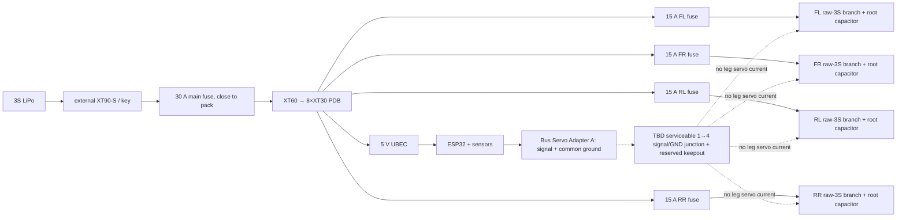

# Build `base_link`, then prove every hardware envelope fits

This chapter turns the parameter/skeleton file into a serviceable body blockout. The result is not a cosmetically finished shell. It is a parametric `base_link` with a continuous design envelope, separable manufacturing bodies, hardware keepouts, and enough evidence to choose the shell split and fasteners later without trapping the battery, phone, fuses, or wiring.


*Use this AI sheet as a shape vocabulary only: revolve, shell, lid, handle, fillet, and front packaging. Its Ø220 × 180 mm upper body, 3 mm wall presented as fact, lid-ring dimensions, handle dimensions, and pictured connector details are not MIST specifications. Current MIST uses an Ø180 × 260 mm cylinder before dome/handle; every unmeasured interface below stays visibly provisional.*

## What this chapter freezes—and what remains open

Freeze these facts:

- body cylinder outside diameter `body_dia = 180 mm`;
- cylinder height `body_h = 260 mm`, excluding dome and handle;
- body origin at the cylinder-axis/bottom-plane intersection;
- +X forward through the phone face, +Y robot-left, +Z up;
- hip-roll axes at radius `mount_r = 100 mm`, Z=`leg_mount_h = 35 mm`;
- FL/FR/RL/RR radial planes at `+25°`, `-25°`, `+109°`, `-109°`;
- portrait Xiaomi Mi 9 SE nominal envelope `147.5 × 70.5 × 7.45 mm`;
- nominal HOOVO pack envelope `104 × 34.5 × 24.5 mm`;
- four powered wheel legs, four raw-3S leg branches, and the signal/power separation in §6;
- the Neptune 4 Pro nominal build volume `225 × 225 × 265 mm`.

Keep these provisional or unresolved:

- `shell_wall = 3 mm` is a starting wall, not a tested final wall;
- deck and lid blockouts use their own provisional thicknesses such as `deck_t`;
- exact shell split plane(s), seam overlaps/keys, insert geometry, screw count, screw spacing, and gasket/gap do not exist in the source material;
- battery orientation and extraction direction;
- board/fuse/connector coordinates and mounting holes;
- phone case/foam, camera bump, buttons, USB plug, bend allowance, bezel retention, and recess depth;
- cable bend radii, bundle diameters, service-loop lengths, tie-point spacing, and grommet sizes;
- final PETG slicer settings and structural-body print orientation.

Do not solve an unknown by drawing a plausible screw pattern. Reserve space, measure the real item, choose the load path, print a coupon, then commit the holes.

## 1. Structure the Browser before making a cylinder

Create `base_link` as an internal component in the Hybrid design:

1. Activate the default/root component.
2. **Design > Solid > Assemble > New Component**.
3. Type = standard Part, **External off**, name `base_link`, Parent = root, **Activate on**.
4. Reactivate root, right-click `base_link` > **Pin**, then reactivate `base_link`. Pin the base once at the world origin; do not add Ground To Parent as a second base constraint.
5. Keep `00_MASTER_LAYOUT` visible but do not edit it from this component.

Use one component for the rigid body system and multiple named manufacturing bodies inside it:

```text
base_link
├── Sketches
│   ├── SK10_BARREL_PROFILE
│   ├── SK11_DECK_BLOCKOUT
│   ├── SK12_LID_BLOCKOUT
│   └── SK13_SEAM_KEEP_OUTS
├── Construction
│   ├── PL_PHONE_TANGENT
│   ├── PL_FL_RADIAL / PL_FR_RADIAL
│   ├── PL_RL_RADIAL / PL_RR_RADIAL
│   └── PL_SPLIT_CANDIDATE_*        ← construction only until selected
└── Bodies
    ├── B_barrel_continuous
    ├── B_deck_blockout
    ├── B_lid_blockout
    └── B_*_split                    ← only after the split gate passes
```

`base_link` is a kinematic component. `B_barrel_continuous`, deck, lid, and later split sections are manufacturing bodies. They may print separately yet remain fixed together during operation. If a service lid needs separate BOM identity or removal animation later, promote it to a component and rigidly attach it in the operating assembly; do not create a fake revolute joint merely because it is removable.

Create a second grounded internal component called `90_HARDWARE_ENVELOPES`. Put no production shell geometry in it. Its translucent dummy bodies may overlap until layout work resolves them, but they must never be targets of shell Join/Cut operations.

## 2. Use a continuous barrel as design intent

Model the nominal barrel continuously first. Choose manufacturing splits only after the phone, battery, electronics, leg roots, and service paths are visible.

### 2.1 Sketch an explicit wall instead of trusting Shell

1. Activate `base_link`.
2. **Create Sketch** on the component XZ origin plane.
3. Press `P`; project only the origin and the vertical body-axis reference from `00_MASTER_LAYOUT`, with Projection Link on.
4. Draw a vertical centreline through the origin. Set its linetype to Centerline and dimension it `body_h`.
5. Draw a closed rectangular half-section on +X:

   - outside radial edge at `body_r`;
   - inside radial edge at `body_r-shell_wall`;
   - bottom at Z=`0 mm`;
   - top at Z=`body_h`.

6. Constrain vertical/horizontal edges and dimensions until the profile is fully constrained.
7. Finish Sketch and rename it `SK10_BARREL_PROFILE`.
8. **Solid > Create > Revolve**:

   - Profile = the thin closed wall section;
   - Axis = the vertical centreline;
   - Angle = `360 deg`;
   - Operation = **New Body**.

9. Rename the result `B_barrel_continuous`.

Nominally, the outer diameter is 180 mm and the 3 mm starting wall leaves `body_inner_dia = 174 mm`. Inspect > Measure should confirm both.

This revolve-first method makes the outside and inside datums explicit and is usually more stable than shelling a tall cylinder. `Solid > Modify > Shell` remains a valid alternative for a sculpted body, but it can fail when later fillets, split faces, or small radii make the offset self-intersect. If you use Shell, decide whether the 180 mm parameter describes the outside or the pre-shell blank and preserve that convention.

### 2.2 Create only a deck blockout

The deck carries battery/electronics and transfers leg loads into the body, but no verified deck thickness, rib field, or fastener pattern exists. Use a visible placeholder:

1. Create `SK11_DECK_BLOCKOUT` on the XY plane at Z=`0 mm`.
2. Draw two concentric circles: outside diameter `body_dia`, inside service opening chosen only after the hardware layout. Until then, use a full disc profile for volume checking and mark it PROVISIONAL.
3. **Solid > Create > Extrude** the disc upward by provisional `deck_t`, Operation **New Body**.
4. Rename it `B_deck_blockout`.

Do not call a 3 mm disc structurally approved. A final deck can be locally thicker, ribbed, or built as a lower mount ring plus removable electronics tray. Local ribs and load-spreading washers/inserts often add stiffness more efficiently than increasing every wall.

### 2.3 Create a separable lid/dome placeholder

1. **Construct > Offset Plane**, select the XY plane, distance `body_h`.
2. Name it `PL_LID_DATUM`.
3. Create `SK12_LID_BLOCKOUT` on that plane; draw a centred circle Ø`body_dia`.
4. Extrude upward by a separately named provisional lid blockout thickness, Operation **New Body**; rename `B_lid_blockout`.

Keep it separate from the barrel. The finished lid may gain a dome, lip, handle, seal, or latch, but the source does not define their dimensions. A handle that lifts the robot is a structural part: it needs a known load path, inserts/bolts, print orientation, and proof load. A decorative AI-style handle may not be used to lift a ~3.2–3.5 kg robot.

Do not add lid-retention holes yet. Reserve a continuous annular seam zone, then place holes after choosing screw/insert hardware and confirming tool access from both sides.

## 3. Create the four leg-root interface planes

The body must meet the exact kinematic axes without inheriting the AI model’s equal 90° spacing.

For each azimuth:

1. Show `SK00_TOP_MOUNTS` and the origin Z axis.
2. **Construct > Plane Through Two Edges**.
3. Select the corresponding origin→H0 radial construction segment and the Z axis. The intersecting lines define the radial vertical plane without retyping an angle.
4. Name the planes `PL_FL_RADIAL`, `PL_FR_RADIAL`, `PL_RL_RADIAL`, `PL_RR_RADIAL`.
5. On each plane, create a small construction sketch and project its H0/H1 points from `SK00_TOP_MOUNTS` plus the Z=`leg_mount_h` datum.

These planes establish axis location and bracket direction. They do not establish a hole pattern. Model each body-side mount first as an envelope/saddle that reaches the H0 axis at radius 100 mm and Z=35 mm. The leg chapter supplies servo/horn envelopes and double-support strategy after physical measurement.

Keep seam candidates, phone openings, fuse holders, and vertical cable trunks away from the complete mount/screw/tool keepout—not merely from the visible bracket body. Drive the leg through ROM before cutting the shell around it.

## 4. Model hardware as envelopes, not downloaded truth

Create one named body per item inside `90_HARDWARE_ENVELOPES`, or one child component per item if independent positioning, mass, or visibility is useful. Use **New Body**, never Join. Apply obvious translucent appearances by system, for example:

- battery/raw 3S: red;
- 5 V logic: amber;
- controller/boards: blue;
- phone/sensors: cyan;
- access/hand/tool keepouts: transparent magenta;
- wire routes: green for signal, red/black for raw power.

### 4.1 Canonical and provisional envelopes

| Envelope | Nominal size | Confidence | What is still missing |
|---|---:|---|---|
| Xiaomi Mi 9 SE | `147.5 × 70.5 × 7.45 mm`, 155 g | High for naked phone | Case/protector, camera bump, side buttons, foam, USB plug and bend, strap lips |
| Phone pocket starting volume | `148.5 × 71.5 × 8.45 mm` from parameter formulas | Provisional | Print/material fit, corner radius, insertion direction, retention |
| HOOVO 3S 2200 | about `104 × 34.5 × 24.5 mm`, about 174 g | Medium | Real soft-pack bulge, lead exit, connector, strap compression |
| ESP32 DevKitC clone | about `55 × 29 × 13 mm` | Medium | Actual 30/38-pin board, USB connector, headers, cable bend, mounting holes |
| Bus Servo Adapter A | `42 × 33 mm`, height unresolved | Medium/low | Connector/body height, plugs, mounting holes, cable extraction |
| 5 V 5 A UBEC | about `43 × 21 × 8 mm` | Medium | Wire exits, heat, actual shrink-wrap outline, mounting method |
| XT60-to-8×XT30 PDB | about `45 × 45 × 18 mm` | Low/medium | Exact connector overhang, mounting holes, solder/lead exits |
| Inline blade fuse holder ×5 | about `45 × 20 × 15 mm` each | Medium | Wire-loop length/gauge, cap opening direction, fuse-pull/tool corridor |
| 4700 µF 25 V cap ×4 | about Ø`16 × 25–30 mm` | Medium | Exact delivered height, lead insulation, clamp/support |
| VL53L0X breakout | roughly `21 × 18 × 3 mm` for the larger reference board | Medium | Actual AliExpress board, connector/pins, optical clear cone |
| XT90-S connector | roughly `25 × 20 × 10 mm` | Low/medium | Actual extension length/orientation and hand grip |
| XT90 access dummy | `70 × 28 × 18 mm` | Provisional | It is only a hand/loop reservation, not a verified connector envelope |

All dimensions above are intake placeholders. Measure the shipped item and replace the matching MEASURE row before designing mounting holes, clips, or close-fit pockets.

### 4.2 Phone envelope and curved-barrel depth

The phone is portrait on the +X face.

1. In `base_link`, **Construct > Offset Plane** from the YZ origin plane by `body_r` toward +X; name it `PL_PHONE_TANGENT`.
2. Activate `90_HARDWARE_ENVELOPES` or a child `ENV_phone` component.
3. Create a sketch on `PL_PHONE_TANGENT`.
4. Draw a Center Rectangle centred on Y=0 and Z=`phone_center_z`:

   - width along Y = `phone_w`;
   - height along Z = `phone_h`.

5. Extrude the rectangle by `phone_t`, Operation **New Body**, and rename `ENV_phone`.
6. Create separate construction rectangles for `phone_pocket_w × phone_pocket_l` and `phone_frame_w × phone_frame_l`.

Do not cut the barrel yet. A flat phone across a curved shell consumes depth even when the phone is thin. For radius `body_r`, the centre-to-chord depth for width `w` is:

```text
curve_depth = body_r - sqrt(body_r^2 - (w/2)^2)
```

Using the 71.5 mm pocket width gives roughly 7.4 mm; using the 77.5 mm frame width gives roughly 8.8 mm. This is why portrait costs about 8 mm of barrel interior while landscape costs tens of millimetres. Check the exact section in Fusion; do not use the rounded value as a recess command.

Choose deliberately among:

- **recessed/flush:** clean and protected, but costs interior depth and weakens the curved shell opening;
- **surface pod:** preserves interior volume and simplifies sealing, but protrudes and increases impact lever arm;
- **hybrid frame:** shallow recess plus external protective rim; usually the practical compromise.

Before any Cut, add physical-phone keepouts for camera, buttons, speaker/mic, charging connector and cable. Confirm the phone can slide out without first removing the full barrel or a leg.

### 4.3 Battery envelope

Create `ENV_battery` as a rectangular box with `battery_l`, `battery_w`, `battery_h`, then add separate padding, connector, removal, and abnormal-pack keepouts. Do not reuse servo-pocket clearance or clamp the pouch.

The mass model places the battery mass centre around Z=40 mm and keeps it low/central; this is a CoM target, not a declaration that the physical pack’s height is 40 mm. Position the envelope low and close to the axis, then explore rearward placement to counter the front phone. Preserve:

- a straight extraction corridor at least as large as the pack plus wires/strap release;
- two real 20 mm-class strap routes or an equivalent tested strap-and-lip retention scheme;
- clearance for pack bulge and connector lead;
- no sharp printed edge against the pouch;
- access without pulling on the battery wires;
- retention in every robot orientation—tape is not retention.

Do not freeze a tray around 104×34.5×24.5 until the real soft pack is measured. Keep the tray adjustable because a later higher-capacity wheel-focused pack will change both envelope and mass.

### 4.4 Boards and fuse holders

For each board/module:

1. Activate its envelope component/body context.
2. **Solid > Create > Box**, or sketch a centred rectangle and Extrude the nominal height.
3. Operation = New Body.
4. Rename immediately (`ENV_pdb`, `ENV_esp32`, `ENV_bus_adapter`, `ENV_ubec`).
5. Add separate connector/plug keepout boxes where dimensions are known; otherwise label them `TBD_MEASURE` and leave extra visible space rather than inventing a tight cutout.

Arrange the PDB and main fuse low and near the battery. Keep ESP32/sensors on the 5 V logic side and away from high-current loops where practical. The phone compass is particularly sensitive to motor currents, magnets, speakers, and power wiring.

Create five fuse-holder envelopes. The main fuse must sit physically close to the battery because every centimetre before it is unfused. The four branch fuses must remain individually reachable and identifiable without removing a leg. Model the cap-opening/fuse-pull direction as a transparent corridor; a holder that geometrically fits but cannot release its fuse fails.

### 4.5 Leg-root capacitors and connector corridors

Create one cap envelope as a cylinder Ø16 mm × 30 mm, then make four occurrences placed near the four H0 regions. Do not circular-pattern them at 90°; use the actual four radial planes.

Each capacitor is across raw servo V+ and GND at a leg root, never inline. Reserve insulated lead space, strain relief, and a clamp/support so vibration is not carried by the capacitor leads.

Reserve an external XT90-S/anti-spark hand corridor. The 70×28×18 mm dummy is intentionally conservative but unverified. The key/disconnect must be reachable without putting fingers into a moving joint or removing the phone. Confirm the actual connector can be gripped, separated, and reconnected with the chosen shell/lid installed.

## 5. Plan service paths before cutting vents or decoration

Write the removal sequence in plain language, then prove it with Fusion visibility and motion:

1. isolate power at the external XT90-S/key;
2. open the service lid without moving a leg;
3. remove/release battery straps;
4. disconnect and extract the pack without pulling its leads across a sharp edge;
5. pull any one of the five fuses;
6. reach USB/data and board connectors;
7. remove the phone without dismantling the lower chassis;
8. reach the fasteners that join shell sections;
9. restore cables into strain relief without trapping them under the lid.

Use **Inspect > Section Analysis** on axial and radial planes. A top view alone will not expose a connector trapped behind the phone or a fuse whose cap opens into the shell.

Create construction sketches named `PATH_RAW3S`, `PATH_5V`, `PATH_BUS`, and `PATH_SERVICE`. Lines represent intended cable centrelines, not final tunnels. Keep raw 3S, logic 5 V, and signal routes visually distinct. At every body penetration, reserve a rounded/grommeted edge and strain relief; final radius/diameter waits for the actual cable bundle.

No cable may become taut at full leg travel. Flex should occur in a deliberate service loop, not at a 5264 plug or servo case exit. The ordered 5264 option was 300/900 mm and the delivered length remains unresolved; raw silicone-wire route lengths are also not known. Do not publish cut lengths from the CAD blockout.

## 6. Two non-negotiable integration gates

### 6.1 Driven-wheel gate

The AI body/leg posters often end in a fixed foot. MIST does not. Each leg has q1, q2, q3, and one powered wheel link, for sixteen installed STS3215 servos total. The body layout must therefore provide four leg-root power/signal exits and cable paths that remain safe through full ROM.

Gate conditions:

- four distinct leg-root route/connector keepouts exist at the real azimuths;
- shell, deck, and seam geometry do not block the wheel-servo bus path;
- each route includes a service loop outside horn/gear/pinch zones;
- the body layout does not assume a passive foot or a fixed wheel;
- the leg/tibia design retains space for the recommended later wheel-at-knee belt/axle retrofit, even though v1 is all-direct.

If a body concept works only after deleting the wheel-servo cable or replacing the wheel with the poster’s foot pad, reject the body concept.

### 6.2 Servo-bus and power-domain gate

The mechanical body must make the intended power domains possible, while
keeping the unresolved signal/common-ground fan-out visible. The diagram below
is a conceptual routing contract, not a proven harness drawing:



Gate conditions:

- the Bus Servo Adapter A envelope and cable route carry signal/common reference only;
- a labelled, accessible keepout remains for a continuity-verified 1→4
  signal/common-ground junction; no hub/Y-splice is claimed proven yet;
- no body connector scheme routes leg servo current through the adapter;
- raw 3S and regulated 5 V connector/route families are visibly separated and labelled;
- XT60/XT30 remain raw 3S in this build;
- four branch fuses and four root capacitors fit and remain serviceable;
- common ground between raw rail, UBEC, ESP32, adapter, and servo bus is physically routable;
- UBEC heat and wire exits have space; logic cannot be accidentally plugged into raw 3S.

Passing a geometric interference check while violating this topology is a failed body design.

## 7. Choose a manufacturing split only after envelopes pass

The nominal 180×260 mm barrel technically fits inside a 225×225×265 mm machine envelope, but 5 mm of nominal Z headroom is not useful process margin. It leaves no comfort for first-layer/brim strategy, machine tolerances, top travel, or a real lid feature. A tall one-piece shell is also a long, expensive failure if it warps or loses adhesion.

### 7.1 Split strategies

| Strategy | Advantages | Costs/risks | Use |
|---|---|---|---|
| One vertical barrel | Few seams; clean visual surface | Near-zero Z margin, long print, warp/adhesion risk, poor repairability | Design/reference body only unless the exact printer workflow proves it |
| One horizontal circumferential split | Shorter prints; simple ring datum; halves can be replaced | Seam interrupts vertical stiffness; needs overlap/keys/fasteners and internal tool access | Practical if seam avoids leg plane, phone cutout, and service routes |
| Two vertical half-shells | Low print height; easy inner access while assembling | Long seams, ovalisation, more fasteners, possible seam through phone/mount roots | Useful only with a deliberate rib/registration structure |
| Modular lower mount ring + central barrel + upper service/lid ring | Separates leg loads, enclosure, and service access; failures are cheaper | More interfaces and alignment work | Preferred concept to evaluate for MIST, not a frozen geometry |

The current source says “fits whole but consider splitting” and “modular/bolted”; it does not define where or how. Treat the modular-band approach as a design hypothesis, not a finished instruction.

### 7.2 Fusion split workflow

Keep `B_barrel_continuous` as the parent design body. For each candidate:

1. **Construct > Offset Plane** from XY at the candidate Z; name `PL_SPLIT_CANDIDATE_A`.
2. Turn on phone, battery, board, fuse, leg-root, tool, and cable keepouts.
3. Use **Inspect > Section Analysis** at/near the plane.
4. Reject a plane that crosses the phone opening, a leg-root load path, an inaccessible fuse/connector, or a required continuous cable path.
5. When one concept passes, save a named version.
6. Copy the continuous body if you need to preserve an unsplit manufacturing reference.
7. **Solid > Modify > Split Body**:

   - Body To Split = the manufacturing copy;
   - Splitting Tool = the approved construction plane/surface;
   - Extend Splitting Tool on if required;
   - verify the preview creates the intended bodies.

8. Rename every result by physical role, not `Body2`/`Body3`.

Do not add seam overlap, tongue-and-groove, insert bosses, or screw holes until the real fastener/insert and print coupon establish dimensions. Model seam **keepout zones** now; model retention geometry later.

### 7.3 No invented fastener pattern

The active docs provide only a general target of mixed M3 hardware and nyloc nuts. They do not provide body screw count, pitch, seam location, insert diameter/depth, clamp load, or tool angle.

Allowed now:

- construction points labelled `FASTENER_TBD`;
- transparent screwdriver/hex-key corridors;
- a continuous annular/edge zone reserved for retention;
- boss-volume placeholders sized no smaller than the provisional `m3_boss_od`, clearly marked not final;
- split coupons that compare seam/key/insert concepts.

Not allowed now:

- publishing a 6-, 8-, or 12-hole pattern as canonical;
- assuming heat-set inserts without buying/measuring them;
- placing hidden nuts that cannot be held during assembly;
- using self-tappers as the final structural shell standard by default;
- drilling final holes because the pattern “looks even.”

The pattern freezes only after hardware choice, edge distance/load review, tool-access proof, and a PETG seam coupon.

## 8. Print strategy: distinguish known limits from a nonexistent profile

Known:

- Neptune 4 Pro nominal volume is 225×225×265 mm;
- PLA is for geometry/fit coupons;
- PETG is for final shell, deck, mounts, and load-bearing structure;
- TPU is for tires/pads;
- unsupported overhangs around 45–55° need deliberate orientation/support testing;
- use a broad flat bed face where possible;
- bottom-edge `edge_chamfer = 0.5 mm` is a starting elephant-foot relief;
- boss walls start at 2.4 mm radial material but may need more for load;
- large monolithic prints warp and fail expensively.

Not known:

- a final PETG nozzle/bed temperature, cooling, wall count, infill, support, brim, and speed profile for the body;
- final print orientation for barrel sections, deck, dome/lid, handle, or phone frame;
- seam/key dimensions or insert process.

The complete slicer table in `MIST_PRINT_TEST_KIT.md` is a **PLA coupon profile**, not a validated PETG body profile. Do not copy its 15% infill/support policy into a load-bearing barrel/deck instruction.

Before a full section:

1. export the candidate body alone;
2. orient it in the actual slicer;
3. check bounding box with at least the established 5 mm XY safety margin;
4. inspect support access/removal and layer direction at load-bearing bosses;
5. print a small seam/wall/boss coupon in the same PETG, orientation, wall settings, and insert method;
6. update shell/seam parameters from the coupon;
7. only then release the large print.

## 9. Mass and centre of mass are body design inputs

### 9.1 Current mass targets

| Item/bucket | Working mass | Placement meaning |
|---|---:|---|
| Shell + deck + lid target | about 900 g | Structural-body budget, not a guaranteed result |
| STS3215 ×16 | 55 g each, 880 g total | Distributed through body/legs |
| Battery | about 174 g | Low/central, mass-centre target around Z=40 mm |
| Phone + frame/straps package | about 205 g | Front, centre about Z=170 mm |
| Electronics allowance | about 350 g | Low, model target around Z=15 mm |
| Harness allowance | about 150 g | Distributed, model target around Z=60 mm |
| Wheel | about 60 g each | Distal; update from actual hub+tire |
| Approved-layout total target | about 3223 g | Simulation baseline |
| Current practical expectation | roughly 3.25–3.55 kg | Includes uncertainty and potentially heavy printed structure |

The older printable estimate was about 1.74 kg for all printed parts and about 3.2 kg total, but the referenced generator/native CAD is absent and that geometry cannot be audited here. Treat 900 g as a body budget and measure/export the new design rather than copying the old total.

### 9.2 Fusion workflow

1. Assign **Modify > Physical Material** to real solid bodies. Use PETG density only as a solid-volume reference.
2. Right-click components/bodies > **Properties** to inspect volume and mass where available.
3. Use **Inspect > Center of Mass** for the assembly.
4. For purchased envelopes, use calibrated custom density or a named, positioned hidden mass-proxy body and exclude the proxy from manufacturing export. Do not assume a portable typed component-mass override exists, and do not give an empty plastic box the density of the real battery/phone electronics.
5. For printed parts, Fusion’s solid PETG mass assumes 100% solid. Walls, top/bottom skin, ribs, and infill do not equal a simple “70% infill factor.” Use slicer estimates, then weigh coupons and final parts.

Avoid double-counting:

- if the printed phone frame is included in the shell/printed mass, add only the phone and straps separately;
- a battery dummy envelope is not its mass;
- sixteen installed servos count; two spares do not;
- harness/fuse-holder mass is not included automatically in cable-free CAD.

### 9.3 CoM tradeoffs

- Moving the battery down/central improves tipping margin; moving it rearward can counter the high/front phone.
- Raising the phone or lid/handle mass worsens tipping even if total mass is unchanged.
- A larger body may create space while adding shell mass and moving hip axes outward.
- Removing 100 g from high shell detail helps every leg’s load; decorative thickening is not free.
- A light shell with a weak lower mount ring is not a win. Concentrate material along leg-load paths, deck/ring joints, strap anchors, and fastener bosses.

After every major shell/split/layout change, recompute mass/CoM and rerun the simulator with the updated shell/battery/phone masses and positions. Fusion CoM at one pose does not replace stability checks across gait poses.

## 10. Body-design tradeoffs

| Decision | More of it gives | But costs | Required recheck |
|---|---|---|---|
| Shell thickness | Stiffness, screw engagement, impact margin | Interior diameter, mass, print time, warp | CoM, bed fit, wire/board clearance |
| Local ribs | Efficient directional stiffness | Support/orientation complexity, stress concentrations | Tool access, print direction, shell buckling |
| Larger deck opening | Better access and lower mass | Less torsional ring area and fewer mount zones | Leg-load path, lid retention, board protection |
| Deeper phone recess | Protection/flush face | Interior loss, weakened curved shell, connector conflict | Section analysis, frame stiffness, camera/USB access |
| External phone pod | Simple mounting, interior preserved | Impact lever, visual bulk, forward CoM | Drop/strike protection, frame attachment |
| Low central battery | Stability and short main power path | May crowd PDB/deck access | Extraction corridor, strap access, heat |
| More/smaller shell sections | Easier printing and replacement | More seams, fasteners, alignment error | Ovality, stiffness, assembly time, cable pinch |
| One-piece barrel | Continuous skin, fewer leaks/seams | Near-zero Z margin and expensive failures | Actual slicer/machine proof, adhesion, warp |
| Tight electronics packing | Smaller body/free volume | Impossible connectors, cooling, troubleshooting | Plug/fuse/tool corridors, heat, service order |
| Larger service clearances | Easier build/repair | Less packaging space and possibly larger openings | Structural ring area and weather protection |

## 11. Common failures and repair paths

| Symptom | Likely cause | Repair |
|---|---|---|
| Barrel recompute fails after a wall change | Shell offset/self-intersection or detail referenced unstable edges | Return to the simple revolve wall; move fillets/details later in Timeline |
| Barrel measures 186 or 174 mm outside | Shell thickness was added to the wrong side of a 180 mm blank | Reassert `body_dia` as **outside** diameter and rebuild the profile |
| Phone fits front view but collides in section | Flat chord depth/curvature ignored | Section through phone centre/edges; account for ~8 mm portrait curvature cost |
| Phone opening leaves a thin strip at top | AI screen proportions or untested `phone_center_z` copied | Use actual portrait envelope; move/reframe after dome and structural margin review |
| Battery box fits but cannot leave | No extraction corridor or cable/strap release modeled | Add transparent swept removal volume; change tray/lid before fasteners |
| Fuse holder fits but fuse cannot be pulled | Only holder body was modeled | Add cap/fuse/tool corridor and prove with Section Analysis |
| Electronics appear to fit until cables are added | Connector/plug/bend keepouts missing | Model each plug and cable direction; keep unknowns visibly oversized/TBD |
| Shell seam crosses a leg root | Split chosen before kinematic/load envelopes | Move split; preserve continuous lower mount ring/load path |
| Four leg ports are at 90° | AI pattern/circular pattern used | Rebuild from `SK00_TOP_MOUNTS` at ±25°/±109° |
| Logic board sees raw 3S route | Voltage domains packed/labelled ambiguously | Separate raw-3S and 5 V routes/connectors; enforce bus gate |
| Adapter is used as servo-current hub | Electrical topology misunderstood | Route four fused raw-3S branches directly; adapter signal/common ground only |
| Cap is drawn inline with a branch | Schematic misunderstanding | Place across V+/GND at leg root; verify polarity and support |
| Handle looks strong but breaks shell | Decorative body joined without load path/layer proof | Treat as non-lifting or redesign with inserts, ribs, orientation, proof load |
| Calculated PETG mass is implausibly high | Fusion treated every solid as 100% material | Compare slicer estimate and weighed coupon; do not fake density to hide geometry |
| Split bodies have random names/history | Split applied repeatedly without a saved continuous parent | Restore named pre-split version; preserve `B_barrel_continuous`; split once deliberately |
| Final screw holes cannot be reached | Pattern added before tool access | Delete/roll back pattern; reserve tool corridors, then design from real hardware |

## 12. Body and envelope hard gates

### Geometry gate

- `B_barrel_continuous` is Ø180 × 260 mm with the chosen provisional wall and no self-intersection.
- Outer diameter remains authoritative when `shell_wall` changes.
- Four radial mount planes use ±25° and ±109° and meet H0 at R=100, Z=35 mm.
- Deck and lid are named separate blockout bodies; no decorative detail drives core datums.

### Hardware-envelope gate

- Phone is portrait and uses the actual 147.5×70.5×7.45 nominal envelope.
- Phone curvature/recess is checked in section, not only front view.
- Battery, boards, fuse holders, caps, XT90 and connector corridors are visible and named.
- Every MEASURE item remains tagged until the real delivered item is measured.
- Battery and phone have proven removal paths; fuses and USB/data remain accessible.

### Driven-wheel and bus gate

- Four powered-wheel leg routes exist at the real azimuths.
- No fixed-foot assumption appears in shell/service geometry.
- Four fused leg branches and four root capacitors have space.
- Adapter carries signal/common ground only; servo current has a separate raw-3S path.
- Raw 3S, regulated 5 V, signal and common-ground routes are distinct and serviceable.

### Split/print gate

- One-piece 260 mm printing is not declared safe from nominal build volume alone.
- Candidate seams avoid phone opening, leg roots, fuse/connector access and cable paths.
- No final fastener pattern, seam key, or insert geometry is presented without hardware/coupon evidence.
- A same-material/orientation PETG seam/wall/boss coupon passes before a full section.
- Final structural PETG settings are not copied from the PLA coupon profile.

### Mass gate

- Purchased-item masses are represented separately from dummy geometry.
- Printed mass is checked with slicer estimates/scale rather than solid PETG alone.
- Shell/body budget, total mass, and CoM are updated after the chosen split/layout.
- Phone-frame and other printed masses are not double-counted.

Save a named version such as `v1_10_body_envelopes_pass` only when every applicable gate passes. A visually polished body with unresolved battery removal, bus-current routing, or seam hardware remains a blockout.

## 13. Artifact honesty: what is not in this workspace

Several active documents refer to generated CAD assets that are **absent** from the current repository:

- `mist_3d/tools/`;
- `mist_3d/tools/build_printable.py`;
- `mist_3d/tools/generate_variants.py`;
- `mist_3d/printable_v1/`;
- `mist_3d/variants/`;
- the referenced `phone_frame.stl`;
- any native Fusion design, STEP assembly, or GLB for the claimed printable v1 body.

Therefore this guide must not tell the beginner to run those scripts, import those missing models, or trust their claimed seam/orientation geometry. The workspace does contain the six AI panels and the `MIST_print_tests` STL/G-code/coupon manifests. Those coupons are useful evidence for test concepts, not a recoverable production body.

The older print-test artifacts also encode superseded geometry such as a Ø76 wheel coupon and older leg lengths. Do not infer current body interfaces from filenames or missing generators.

There are two honest next steps:

1. build the body natively in Fusion from the parameter/skeleton workflow above and validate it; or
2. restore the missing generator/native CAD with provenance, then audit it against the 12 July master before reuse.

Until one happens, every shell split, fastener layout, phone frame, and final PETG body instruction remains new engineering work—not a recovered finished design.
