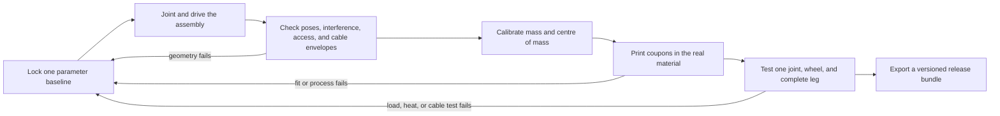

# Validate the moving robot, prove the print, and release the files

This is the point where a tidy-looking model has to become a buildable robot. Do not treat a clean render, a successful joint animation, or a slicer preview as proof on its own. MIST needs three different kinds of evidence:

- Fusion proves the solid geometry, assembly relationships, access, and current-pose clearances.
- The MIST simulator checks reach, torque, stability, power, and a sequence of poses.
- Coupons and a one-leg rig prove what the printer, servo, horn, cable, and fasteners actually do.

Only release the other three legs after all three agree.


*Use the AI sheet above as a visual index, not as a specification. Its useful idea is the order: joint the assembly, pose it, inspect it, then export it. Its two-joint foot-leg, joint limits, `Inspect > Drive Joint` path, and collision wording are wrong for current MIST. The build has q1, q2, q3, and a driven wheel at every leg; use the limits and paths below.*

## Current Fusion wording, checked 12 July 2026

This guide targets Autodesk Fusion `v2704.1.23`, the 9 July 2026 hotfix. Autodesk's current product name is **Fusion**, although filenames, search results, and older tutorials still say **Fusion 360**.

| Task | Current place to start | Reliable fallback |
|---|---|---|
| Create or edit assembly relationships | Design workspace > Assemble | Press `S`, search the exact command name |
| Move joints to exact values | Assemble > Drive Joints, or right-click a joint | Search `Drive Joints` |
| Edit limits | Right-click joint > Edit Motion Limits | Edit the joint, then open Joint Motion Limits |
| Prevent selected hard parts passing through each other | Assemble > New Contact Set, then enable Contact Sets | Search `Contact Set` |
| Find solid overlap | Inspect > Interference | Search `Interference` |
| Cut the view open | Inspect > Section Analysis | Search `Section Analysis` |
| Show assembly centre of mass | Inspect > Center of Mass | Search `Center of Mass` |
| Give bodies engineering density | Modify > Physical Material | Search `Physical Material` |
| Export one printable part | Right-click body/component > Save As Mesh | Utilities > Make > 3D Print |
| Export the design or neutral CAD | File > Export | Use the Data Panel/web export if cloud translation is required |
| Start a drawing | Workspace menu > Drawing > From Design | Right-click a component > Create Drawing |

The `S` shortcut matters. Fusion's panels change with workspace, document type, licence, and window width; command search is more dependable than hunting for an icon that a tutorial placed somewhere else.

## Release blocker: the repo does not yet contain one aligned build baseline

For the guide, `MIST_FUSION_MASTER_DIMENSIONS.md` and `mist-fusion-parameters.csv` are the authority. Several downstream files still describe older designs. Do not average the numbers or silently choose whichever model looks better.

| Conflict or missing item | What is present now | What must happen before a print release |
|---|---|---|
| Geometry baseline | Fusion master: `d1=32`, `femur=110`, `tibia=70`, wheel Ø70, mounts at ±25° and ±109°. `sim/js/config.js` still defaults to `35/120/140`, wheel Ø70, mounts at ±50° and ±130°. | Create and save one simulator JSON that matches the master values. Do not export firmware limits or bench predictions from the current defaults. |
| Old leg coupons | `MIST_PRINT_TEST_KIT.md` calls 65/85 mm the CAD baseline; its wheel slice is Ø76. | Keep the fit and mechanism coupons as experiments. Regenerate or remodel any geometry coupon that is meant to certify the 110/70/70 design. The existing tibia ladder cannot select 70 mm. |
| Mass | The Fusion master records a 3223 g Layout A target. `MIST_MATERIAL_DIMENSIONS_MASS.md` expects roughly 3.25–3.55 kg and says the old 1740 g printed-kit estimate needs a CAD v2 rerun. | Recompute from the actual Fusion geometry and weighed components. Treat 3223 g as a comparison target, not a measured result. |
| Native manufacturing CAD | There is currently no `.f3d`, `.f3z`, STEP, 3MF, GLB, or OBJ in `mist_3d/`. | Save the first native Fusion milestone and create the export bundle described later in this chapter. |
| Referenced automation | Older docs name `mist_3d/tools/build_printable.py`, `build_print_test_kit.py`, `slice_neptune4pro_cura.py`, `analyze_mesh.py`, and related output. Those scripts and `printable_v1/` are absent. | Restore the scripts from a known source or mark their reports historical. Do not claim that an absent script can regenerate the current files. |
| Moved print kit | The checked-in G-code and STLs are under `mist_3d/MIST_print_tests/`, but the manifests and CSV still point to `<LOCAL_HOME>\Downloads\MIST_print_tests`. Some individual STLs are nested below `not_imported_from_cura_screenshots/`. | Rebuild the manifest with repo-relative paths when the kit is regenerated. Preview every selected G-code locally; do not trust a stale absolute path. |
| Hardware interfaces | Servo body envelope is reasonably sourced; ear geometry, output-axis position, auxiliary stub, horn recess/bolt circle, cable exit, battery size, and several board heights remain measure-on-arrival items. | Measure the received parts, update parameters, and pass the PETG interface coupons. |
| Wheel architecture | Four fixed radial wheel headings do not give ordinary no-slip steering. Scrub/skid, omni/caster, steering, or adjustable pods remains a design choice. | Resolve the wheel/contact approach before freezing tire width, pod clearance, and drive-pose validation. |
| Downstream integration | The build-phase map and `sim/js/exports.js` now both assign IDs 9–12 to RR and 13–16 to RL. Four leg-root bus/power taps are not yet physically resolved. There is no URDF generator in the repo. | Verify the shared ID map on one unpowered/low-torque bench leg, lock the root-tap design before drawings and firmware are labelled final, and treat URDF as a later deliverable rather than an existing export. |

The validation loop is deliberately circular. A failed coupon can change a parameter; that change sends the affected checks back to the start.



## Build an assembly that can be tested

### Audit components before adding more joints

Fusion joints act between **components**, not loose bodies. Do this once at the top-level Hybrid Design:

1. Expand the Browser and turn on component colours with `Shift+N`.
2. Confirm there is one component per rigid link: `base_link`, four `*_root_mount` components rigidly attached at the explicit body origins, four `*_hiproll`, four `*_femur`, four `*_tibia`, and four `*_wheel` components. A component may contain several bodies that are bolted together and never move relative to each other. The fixed root mount may be merged into `base_link` only in a documented export representation.
3. Put servo envelopes, horns, bearings, fasteners, and printed geometry inside the rigid link component that owns them. If a servo case is fixed to the femur and its horn drives the tibia, the case belongs to the femur and the horn/output-side interface belongs to the knee relationship.
4. Pin only `base_link` to the world. In current Fusion, **Pin** fixes a component to the top-level coordinate system. **Ground To Parent** is a different child-to-parent relationship. Pinning a leg link as well as the base over-constrains the mechanism.
5. Use a Rigid Group only for parts that really are one rigid object. Never include both sides of a moving joint in the same Rigid Group.
6. Run `Ctrl+B` to Compute All. Clear red and yellow timeline problems before debugging motion.

If parts are already positioned correctly, use **As-Built Joint**. It defines relative motion without pulling the parts together. Use the ordinary **Joint** command when the joint should also place an unpositioned component. A leg that jumps across the model when you click OK usually needed an As-Built Joint, or the two joint origins do not describe the same axis.

### Create the MIST joint chain

The local axes and names must match `sim/js/kin.js` and the Fusion master table:

| Joint | Components | Type | Axis and zero | Design limit |
|---|---|---|---|---|
| `{leg}_root_fixed` | `base_link` → `{leg}_root_mount` | Rigid placement | explicit +25/−25/+109/−109° body origin; no degree of freedom | fixed |
| `{leg}_q1_roll` | `{leg}_root_mount` → `{leg}_hiproll` | Revolute | radial, horizontal `Xm`; zero with the hip-roll bracket at its modelled neutral | −60° to +60° |
| `{leg}_q2_hip` | `{leg}_hiproll` → `{leg}_femur` | Revolute | rolled `−Ym`; zero with femur vertically down | −35° to +110° |
| `{leg}_q3_knee` | `{leg}_femur` → `{leg}_tibia` | Revolute | parallel to q2; zero with tibia in line with femur | −135° to +135° |
| `{leg}_wheel` | `{leg}_tibia` → `{leg}_wheel` | Revolute | wheel axle; no useful positional stop in wheel mode | leave unlimited for geometry tests |

Use `FL`, `FR`, `RL`, and `RR` consistently. Test one leg before duplicating it. When it works, use associative instances and **Duplicate With Joints** at four explicit mount origins. Do not use the AI poster's four-way 90° circular pattern: MIST's mount rays are `+25°, −25°, +109°, −109°`.

For each revolute joint:

1. Select the two components, not two bodies in the same component.
2. Pick the cylindrical face or a named Joint Origin at the real shaft centre.
3. Confirm the axis arrow. Flip it if needed so increasing Fusion angle agrees with the q sign convention above.
4. Enter the minimum, maximum, and a neutral rest value in Joint Motion Limits.
5. Use **Preview Motion** to check the one degree of freedom.
6. Right-click the completed joint and choose **Animate Joint Relationships**. Unlike `Animate Joint`, this includes the other joints, grounds, and contact relationships.

Fusion joint limits are CAD relationship limits, not firmware/controller limits and not collision detection. A limit stops the model relationship at a number. It does not program the servo, protect hardware, or prove that the cable, wheel, horn screw, case, or neighbouring leg is clear before that number.

### Keep a joint-direction record

A model can move correctly while the physical servo is installed in the opposite sense. Record the mapping rather than fixing it by eye later:

| Leg/joint | Fusion positive motion observed | Sim positive motion observed | Physical servo positive tick observed | Firmware `MIST_SIGN` | Status |
|---|---|---|---|---:|---|
| FL q1 | record during drive test | record from aligned sim | record on one-servo bench | `+1` or `−1` | open |
| FL q2 |  |  |  |  | open |
| FL q3 |  |  |  |  | open |
| FL wheel |  | n/a | forward wheel rotation |  | open |

Do this for all four legs after the hardware is centred at tick 2048. Never make a big geometry error disappear by giving one servo a large software centre offset.

## Validate driven poses, not a single attractive stance

### What the motion commands do

| Fusion tool | What it proves | What it does not prove | Best MIST use |
|---|---|---|---|
| Drag component | The mechanism has some freedom | Exact angle, complete range, or repeatability | Quick smoke test only |
| Preview/Animate Joint | One joint's axis and nominal limits | Relationships elsewhere in the assembly | Catch a flipped or misplaced axis |
| Animate Joint Relationships | The chosen joint moves with other relationships active | A full timed gait or structural load | Check a leg chain and selected Contact Sets |
| Drive Joints | One or more joints can be set to exact numeric inputs | Torque, inertia, compliance, friction, or cable flex | Reproduce simulator poses exactly |
| Motion Study | A kinematic sequence based on assembly joints | Motor sizing, stress, traction, or dynamics | Scrub a pose sequence and find mid-stroke geometry problems |

The current Fusion Motion Study is kinematic. A sequence playing smoothly is useful evidence about relationships and geometry, but it is not evidence that a 12 V STS3215 can produce the motion under load. The local simulator and the one-leg bench test provide that evidence.

### Make a validation pose battery

Create a worksheet alongside the CAD. Do not store every test position as a `Capture Position` feature in the main design; repeated captures make the timeline hard to reason about. Use a Motion Study or drive the joint values, record the result, then return to the neutral/home position. Use Capture Position only when the assembly's intended saved position genuinely changes.

| Pose ID | Purpose | Geometry to inspect | Simulator evidence |
|---|---|---|---|
| `P00_NEUTRAL` | Normal four-wheel stand | all leg/body gaps, cable slack, wheel/shin gap | Layout A reference is barrel bottom 148 mm above ground and contact radius 176 mm, after the sim baseline is aligned |
| `P01_TALL` | Maximum useful height | hip case vs shell, knee extension, cable tension | scan roughly 170–171 mm; 171 mm came from the 111/70 study and is not guaranteed for rounded 110/70 CAD |
| `P02_LOW` | Low squat/park | femur vs barrel, wheel vs tibia, battery/deck access | simulator `Squat cycle` low point |
| `P03_Q1_MIN` / `P04_Q1_MAX` | Hip-roll endpoints | root slot, servo cable, adjacent body and leg | q1 at −60° and +60° with safe q2/q3 values |
| `P05_Q2_MIN` / `P06_Q2_MAX` | Hip endpoints | horn/yoke, barrel, femur cable | q2 at −35° and +110° with safe q1/q3 values |
| `P07_Q3_MIN` / `P08_Q3_MAX` | Knee endpoints | wheel hub stem, shin carrier, cable bend | q3 at −135° and +135° where reachable |
| `P09_ONE_LEG` | Three-leg support with one wheel lifted | raised leg vs shell and neighbour; cable at full lift | `One leg up (3-leg stance)` endpoints and worst frame |
| `P10_CRAWL_A…D` | Four swing phases | front/rear wheel separation, crossed links, cable sweep | four worst frames from `Crawl gait (4 steps)` |
| `P11_DRIVE` | Chosen physical wheel-heading geometry | tire headings, tire/body clearance, scrub allowance | create only after the fixed-wheel decision; software cannot rotate fixed pods |
| `P12_SERVICE` | Battery, phone, fuse, cap, and connector access | tool path and removal envelope | no simulator equivalent |

Endpoints are necessary but not sufficient. Two curved solids may be clear at both ends and collide halfway through. Sample each large joint sweep at least at the endpoints, zero, and two intermediate values. Add more samples wherever the minimum gap is visibly changing quickly. A Motion Study makes this much faster.

### Pull joint angles from the aligned simulator

After the simulator config matches the master table, it can supply exact q angles for Fusion. Start it from the repo root:

```powershell
python sim\serve.py
```

Open `http://localhost:8123/`, choose a preset and time, then use the browser console:

```js
sim.pose('Crawl', 0.25)
sim.res.legs.map(l => l.q.map(rad => +(rad * 180 / Math.PI).toFixed(1)))
```

The result is `[FL, FR, RL, RR]`, with `[q1, q2, q3]` in degrees for each leg. Enter those values in Drive Joints. If Fusion has the opposite sign on one axis, repair the Joint Origin orientation and update the direction record. Do not negate random numbers until the pictures match.

## Use the right inspection tool

Interference, Contact Sets, Section Analysis, and Measure answer different questions. The AI poster groups them together; that is a common beginner trap.

| Tool | Question answered | Result | Important limitation |
|---|---|---|---|
| Interference | “Do these selected solids occupy the same volume in this frozen pose?” | A list of overlaps and overlap volumes | It does not sweep through motion and does not report a safe positive clearance |
| Contact Set | “Should these selected components stop passing through each other while I move the assembly?” | Motion is blocked at contact | It is computationally expensive and can hide how much clearance is missing |
| Section Analysis | “What is inside this visible model at this cut plane?” | A persistent cut view under the Browser's Analysis folder | It is a view, not a collision test |
| Measure | “What is the distance, angle, area, position, or minimum gap between these selections?” | Numeric values that can be copied | A current-pose measurement can change elsewhere in the sweep |

### Run an interference pass

At every pose in the battery:

1. Hide canvases, sketches, mass proxies, cable states that do not belong to the pose, and cosmetic bodies.
2. Open **Inspect > Interference**.
3. Select the moving links and the components close enough to matter. Start with one leg plus the barrel. Expand to neighbouring legs and internal equipment after the local set is clean.
4. Leave `Include Coincident Faces` off for the first pass. Coincident faces can flood the results with bolt seats, bearing shoulders, and deliberately touching interfaces.
5. Compute. Click each result and identify the two named components and overlap volume.
6. Classify it as `FAIL`, `INTENTIONAL`, or `FALSE/PRESENTATION`. An intentional overlap needs a written reason such as “threaded fastener inside pilot hole”; a coloured screenshot is not enough.
7. Fix all unexplained overlaps. Recompute the same selection set.
8. Use **Measure** on close but non-overlapping pairs and record the smallest clearance.

High-risk MIST pairs deserve their own saved checklist:

- wheel/hub stem against the tibia and wheel-servo carrier;
- femur and hip yoke against the barrel at q1/q2 extremes;
- front wheel against rear wheel through crawl and drive poses;
- horn, centre screw, and output-side bracket;
- servo ears and cable boot against pocket walls;
- battery, strap, XT60, and battery removal envelope;
- phone, frame, USB plug, and front shell;
- PDB/fuse/cap envelopes against the deck, fasteners, and lid;
- cable envelopes against horns, screw heads, and sharp printed edges.

Do not use Interference's optional material-removal behaviour as a shortcut on the master assembly. An interference result is a diagnosis. Repair the owning component parametrically so the design intent remains visible in its timeline.

### Use Contact Sets sparingly

Contact Sets are useful for a bracket acting as a physical stop, a cover closing against a lip, or two links that must never pass through one another while dragged. They are not the default collision checker.

1. Create a New Contact Set for one meaningful pair.
2. Enable Contact Sets.
3. Use Animate Joint Relationships or drag slowly.
4. Note where motion stops, then run Interference/Measure at a nearby driven value to understand the geometry.
5. Disable the set when it is no longer needed.

Avoid `Enable All Contact` on the full robot. Sixteen moving joints, fasteners, envelopes, and deliberately coincident interfaces make it slow and noisy. A stopped motion is also not a pass: it can mean the design collided 20° before its required limit.

### Cut sections that answer one question

Useful section planes are:

- through the q1 and q2 axes, to show shell, saddle, horn, and back support together;
- through the q3 axis and wheel hub, to show the output screw, horn recess, outboard stem, and tire gap;
- radially through a leg-root cable slot;
- through the battery tray and removal direction;
- through the phone, frame lips, and USB connector;
- through screw bosses to confirm wall, pilot, washer, and edge distances.

Name them `SEC_Q1_ROOT`, `SEC_Q3_HUB`, `SEC_BATTERY`, and so on. Fusion stores them in the Analysis folder, so they can be hidden and reused. A section that “looks roomy” still needs measurements. Check the wall or gap with Measure and compare it with the parameter/coupon result.

## Model cable motion as an envelope

Fusion does not turn a swept solid into a physical flexible cable when a joint moves. For MIST, use simple conservative envelopes and then prove the real harness on the one-leg rig.

### Make the neutral cable route

1. Measure the actual 5264 lead bundle diameter, connector body, cable boot, and the straight length that should not bend at the connector.
2. Create a top-level component named `_ENVELOPES_CABLES` and a child such as `ENV_CABLE_FL`.
3. Start a sketch and enable **3D Sketch** in the Sketch Palette.
4. Place the path endpoints at the fixed strain-relief points, not at arbitrary visual locations. Add intermediate points where the cable is clipped or deliberately loops.
5. Use tangent arcs or a smooth spline. Avoid a tight kink at a joint axis or connector.
6. Sketch a circular profile at one end. Set its radius to `measured_bundle_dia/2 + cable_margin`. The current `cable_margin=1 mm` is provisional.
7. Use **Solid > Create > Sweep**, Single Path, Operation `New Body`.
8. Give the envelope a loud translucent appearance and a non-print prefix such as `ENV_`.

The envelope is intentionally larger than the cable. It represents movement, print roughness, ties, and measurement error. It is not part of the mass or print selection.

### Check cable states

Create visible route states for neutral, each relevant joint endpoint, the raised-leg pose, and the worst crawl frame. A simple, honest method is one suppressed/visible 3D sketch and sweep per state: `ENV_CABLE_FL_NEUTRAL`, `_Q1MIN`, `_Q1MAX`, `_LIFT`. Edit each path while the assembly is driven to that pose.

For every state, check:

- no intersection with a rotating horn, wheel, fastener, or sharp edge;
- slack remains at both joint limits;
- the bend occurs in the cable span, not at the connector housing;
- the route cannot fall into the wheel or gear path under gravity;
- the connector can still be unplugged without removing a servo;
- the path length fits the real cable with a service loop, but not so much spare cable that it can snag;
- each moving transition has strain relief on the fixed side and the flex happens away from the crimp.

Measure each sketch path length and put it in a route table. Do not use an unsupported generic bend-radius rule as a final rating; the received cable and supplier data decide that. If no manufacturer minimum exists, start with a deliberately broad loop, flex the cable by hand through the real range, and record the smallest radius that remains relaxed. CAD cannot detect conductor fatigue.

## Make Fusion's mass and centre of mass useful

Appearance and Physical Material are separate in Fusion. Painting a part “PETG black” changes how it looks; it does not give it PETG density. Assign engineering material with **Modify > Physical Material**, then use Appearance only for presentation.

### Use three kinds of mass representation

| Item type | Recommended representation | Why |
|---|---|---|
| Printed shell, deck, link, hub | Actual solid geometry plus a calibrated effective-density material | Preserves the part's spatial mass distribution without modelling every infill line |
| Servo, phone, battery, board, fuse holder | Measured envelope component with density chosen so its calculated mass matches the measured mass | Gives the assembly a usable mass and approximate local CoM |
| Wire, connectors, ties, straps | Several distributed proxy bodies at the real route regions | One 150 g point at the body centre hides the leg-root and moving-harness effect |

Do not depend on a presumed “type the mass here” override. Current Fusion documentation exposes physical materials and calculated physical properties; the portable method is a custom effective density or a mass proxy.

For any body with Fusion volume `V` and a measured target mass `m`:

```text
effective density = m / V
```

Duplicate a similar material into Favorites or a user library, rename it clearly, and set that density. Examples of useful names are `PETG_N4P_4W_30GYROID_R01` and `MASS_PROXY_STS3215_55G`. Do not overwrite the library's generic PETG entry.

The master table's PETG density of 1.27 g/cm³ describes bulk plastic. Multiplying solid volume by a single `0.7` infill factor is acceptable for an early budget but not a release result: walls, top/bottom skins, bosses, ribs, and local solid infill make each part different. Weigh a finished part or a representative coupon made with the release profile, then calibrate that part family.

### Build the mass pass

1. Apply physical materials to all printed bodies.
2. Give each servo proxy 55 g, but keep the two unmounted spares out of the assembly mass.
3. Use 174 g as the battery estimate only until the received pack is weighed. Position its mass at the mounted pack, not at the world origin.
4. Use the current 205 g phone-plus-frame allowance only if the frame has not already been counted inside a printed-part mass. Avoid double counting.
5. Add electronics and harness proxies where they really sit.
6. Right-click each component > Properties and record mass/volume. Investigate default materials and zero-mass surface bodies.
7. Use **Inspect > Center of Mass**, select the complete installed assembly, and show the glyph.
8. Measure the glyph from the world origin and record `(x, y, z)` for neutral, no-payload, and payload configurations.
9. Hide the CoM analysis when doing other heavy calculations; Fusion recalculates it when shown again.

The present honest expectation is roughly 3.25–3.55 kg all-up. A result near 3.223 kg may be good, but only if the printed geometry and every installed item are represented. A much lighter result usually means missing harness/fastener mass or bulk PETG was replaced by an arbitrary low density. A much heavier result often means all printed parts are still treated as solid bulk plastic or an occurrence was duplicated.

Fusion's CoM glyph does not calculate foot loads or a tipping angle. Use it to verify the spatial mass model, then copy the same masses and locations into the simulator. The two models should agree after rounding. Suggested release tolerances are:

- all shared CAD dimensions: exact by parameter, within 0.1 mm when read back;
- total mass: within 2% between Fusion and the saved simulator config;
- CoM X/Y: within 5 mm;
- CoM Z: within 10 mm.

Those are project QA targets, not Autodesk specifications. If a model cannot meet them, document which approximation causes the difference before using its tip or torque result.

## Know which changes invalidate which checks

A parameter edit is cheap. Repeating the wrong half of validation is expensive. Use this impact map.

| Changed parameter or process | Likely consequences | Minimum retest |
|---|---|---|
| `body_dia` | shell circumference and mass, deck fit, interior room, mount radius, stance geometry, bed fit | full joint/pose battery, internal sections, mass/CoM, sim scan, shell slice |
| `body_h` or top payload height | shell mass and print time, cable trunk length, CoM Z, tip margin | mass/CoM, battery and lean sequences, shell print orientation |
| `leg_mount_h` | joint-axis height, ground clearance, leg pose, root cable path, body collision | all driven poses, root section/cable sweep, simulator |
| `d1` | hip package, stance reach, swing mass arm, q1/q2 interference | one-leg full ROM, mass/CoM, torque and reach scans |
| `femur` | reach, stride, servo torque, link mass/stiffness, adjacent-leg collision | full pose battery, gait sequence, beam coupon if section changes |
| `tibia` | axle location, reach, knee torque, wheel/shin gap, belt-retrofit space | q3 sweep, wheel module, gait/interference, simulator |
| `wheel_dia` | axle-to-ground height, body clearance, distance per wheel revolution, required wheel torque, wheel/shin and stride gaps | wheel coupon, q3 sweep, neutral/drive poses, sim power and gait |
| front/rear azimuths | support polygon, adjacent-wheel gap, fixed-wheel rolling direction, duplicate placement | all four mount origins, full-assembly interference, stability/drive tests |
| `beam_w` / `beam_t` | mass, joint pocket room, stiffness, layer-direction strength, print time | section analysis, mass, structural coupon and one-leg load test |
| pocket/diametral/lid clearance | hardware fit and wobble; a single global value may fix one fit and ruin another | only the affected interface coupon, then its assembly module |
| wall count, infill, layer height, flow, or filament | mass, hole size, stiffness, creep, surface and support removal | material calibration plus every safety-critical fit coupon |
| battery/phone/electronics placement | CoM, access, cable length, support loads | service pose, mass/CoM, stability and branch routing |

Keep separate parameters for separate fit meanings. `pocket_clearance_per_side` is per side, so a pocket is `part + 2*pocket_clearance_per_side`. `pin_radial_clearance` is radial, so a free bore adds `2*pin_radial_clearance`, then applies the separately calibrated `hole_diameter_comp` under the documented policy. A press fit, a sliding lid, and a servo pocket should not all share one `fit_clearance` just because they are close numerically.

## Use a coupon ladder, not a miniature production run

The existing `mist_3d/MIST_print_tests/` kit contains useful experiments and verified historical G-code bounds. It is not a current Fusion release. Its G-code was sliced as a PLA profile at 210/60°C, and some geometry targets an older leg. Never edit the temperatures in those files and call them PETG or TPU G-code; material profiles also change cooling, speed, retraction, flow, support, and adhesion.

### Coupon ladder

| Level | Print or test | Question answered | Gate to advance |
|---:|---|---|---|
| 0 | 20 mm dimensional check and first-layer check | Is the machine mechanically sane and using mm? | dimensions repeat and first layer is even |
| 1 | `cal_hole_sizes`, `cal_screw_boss`, `cal_clearance_pegs`, `cal_cable_tunnels` in easy PLA | What does this printer do to small holes, bosses, sliding gaps, and channels? | measurements recorded; no forcing |
| 2 | PETG temperature/stringing tower, then the critical Level 1 coupons in PETG | Did the final material change shrinkage, flow, bridging, or support release? | PETG-specific parameters recorded |
| 3 | measured STS3215 pocket/ear bracket, horn recess/bolt circle, and wheel-hub slice in PETG | Does real hardware fit, sit square, and come out again? | servo case unstrained; horn flat; screws align |
| 4 | one double-shear joint, screw boss, cable clip, and hub in release orientation | Does the load path survive assembly and repeated motion? | no cracks, rub, screw pull-out, or cable pinch |
| 5 | one q1/q2/q3 chain and one TPU tire/hub | Does the whole mechanical corner move through usable ROM? | smooth hand motion first; powered low-speed test only after the fused/current-limited branch, secured stand, reachable disconnect and deadman gates pass |
| 6 | one complete four-servo leg on a secured stand | Do geometry, bus, power, heat, and cable assumptions agree? | approved harness/pinout, fused branch, current limit, physical kill/deadman and Phase 10 pass criteria met |
| 7 | remaining three legs | Is replication now low risk? | only after Level 6 is boring and repeatable |

The current adjustable leg plate is still useful for understanding stance, but its documented 65/85 mm “CAD baseline” is obsolete. The current 110 mm femur is at the end of its femur ladder, while the 70 mm tibia is outside its 75–120 mm ladder. Do not stamp a Layout A pass from that plate.

### PETG release workflow

1. Dry the filament if the surface pops, foams, or strings badly.
2. Run a temperature tower within the spool maker's range. Choose the lowest temperature that gives sound layer bonding and clean bridges, not simply the glossiest result.
3. Use glue stick on smooth PEI as a release layer where needed. PETG can bond too aggressively.
4. Repeat the hole, boss, sliding-fit, servo-pocket, and horn coupons in PETG.
5. Orient loaded parts so the main tension does not peel layers apart. Put joint ears in double shear where practical.
6. Start structural parts with more perimeter material rather than trying to solve every load with very high infill. Walls reinforce bosses, pockets, and beam skins directly; infill mainly supports those skins and changes global mass/stiffness.
7. Slice one structural part, record predicted mass, print it, and weigh it. Use the ratio to update the Fusion effective-density material.
8. Inspect support scars on horn seats, bearing seats, and mating faces. A nominally correct CAD face can be unusable after support removal.
9. Re-run the affected fit coupon after any change to nozzle, wall order, flow, line width, layer height, horizontal expansion, or filament brand.

A reasonable starting experiment for a load-carrying MIST PETG part is 0.20 mm layers, four or five walls, five top/bottom layers, and moderate infill rather than a nearly solid part. It is a starting experiment, not a locked profile. The coupon and one-leg load result decide. More walls increase mass and print time and may tighten small pockets; high infill raises mass and can make a part stiff without fixing weak layer orientation.

### TPU tire workflow

TPU is a separate process. The local field guide's starting range is 20–30 mm/s with minimal retraction and dry 95A filament.

1. Calibrate extrusion and stringing on a small TPU part.
2. Model a short tire sector or narrow ring before a complete tire. Print variants with different wall count and infill, labelled in the geometry.
3. Press each onto the release PETG hub. Check retention, concentricity, and removal without tearing.
4. Measure the mounted outside diameter and width. `wheel_dia` means the loaded tire OD used by the kinematics, not the unconstrained CAD ring before print.
5. Roll the module under a known load. Look for a flat spot, tire creep around the hub, lateral fold, and rubbing.
6. Print one full tire and run the wheel module both directions at low speed before making four.

TPU changes have system effects. More walls or infill make a tire stiffer and usually more dimensionally stable, but increase rotating and unsprung mass. A larger OD increases distance per motor revolution and axle height, but also increases required wheel torque and can reduce wheel/shin clearance. A wider, grippier tire may improve traction and worsen scrub steering. Send the measured mounted diameter and mass back to Fusion and the simulator.

### Record the result

Keep one row per coupon. A photo without settings cannot reproduce anything.

| Revision | Material/spool | Slicer profile | Orientation | Nominal feature | Measured result | Hardware feel | Pass/fail | Parameter changed |
|---|---|---|---|---:|---:|---|---|---|
| example | PETG, spool A | `MIST_PETG_R01` | ear face on bed | pocket width 25.2 | measure after cooling | free/snug/tight | mark pass or fail | `pocket_clearance_per_side` |

## Export the right file for the next job

There is no universal “best CAD format.” Choose based on what the receiver needs.

| Format | Use it for | Keeps | Loses or risks |
|---|---|---|---|
| `.f3d` | editable Fusion source with no external references | Fusion timeline, parameters, internal structure | Fusion-specific; a distributed design may require `.f3z` instead |
| `.f3z` | Fusion archive of an assembly with external references | packaged Fusion design references | not a neutral CAD format |
| STEP `.step/.stp` | cross-CAD solid exchange and geometry audit | precise B-rep solids and component geometry | Fusion timeline, user-parameter intent, joint behaviour, and associativity |
| `.3mf` | primary print mesh handoff | explicit units, multiple objects, mesh, optional colour/metadata | no editable parametric features; slicer-specific settings only if saved by the slicer |
| binary `.stl` | legacy slicer or geometry checker | triangulated surface | units, names, colour, assembly structure; easy to import at the wrong scale |
| PDF drawing | human assembly/inspection sheet | dimensions, notes, views, parts list | not machine-editable and not associative after export |
| DXF | flat templates or sketch exchange | 2D vectors | no 3D design; Personal Use commonly exports DXF from a sketch rather than the full drawing workflow |

Autodesk's current supported-format page lists F3D, 3MF, STEP, STL, and sketch DXF among Personal Use outputs. Drawing features and multi-sheet/export choices can still differ by licence. If a drawing command is unavailable, make separate single-sheet drawings or print the active drawing to PDF; do not replace a missing dimensioned drawing with a screenshot.

### Prepare a release, then export

1. Save a named Fusion version such as `R01_coupon_candidate`. If milestones are available, mark the release point.
2. `Ctrl+B` Compute All and resolve the timeline.
3. Return every joint to `P00_NEUTRAL`.
4. Update external references and resolve red, yellow, or blue component states.
5. Confirm the top-level component and all part names. No `Body1`, `Component7`, or duplicate ambiguous names in a release.
6. Hide AI canvases, construction sketches, section analyses, cable alternatives, mass proxies, and component envelopes unless that export explicitly needs them.
7. Run the final Interference set and mass check from the saved version.
8. Export to a new revision folder. Never overwrite the last known printable revision.

Suggested bundle:

```text
mist_3d/fusion_exports/R01/
  source/
    MIST_R01.f3d              # or MIST_R01.f3z
  exchange/
    MIST_R01.step
  print_mesh/
    chassis_plate_R01.3mf
    barrel_R01.3mf
    hiproll_R01.3mf
    femur_R01.3mf
    tibia_R01.3mf
    wheel_hub_R01.3mf
    tire_R01.3mf
  legacy_stl/                 # only if a consumer needs STL
  slicer_projects/            # slicer-created 3MF, with machine/profile/placement
  drawings/
    MIST_assembly_R01.pdf
    MIST_interfaces_R01.pdf
  sim/
    mist_sim_config_R01.json
    mist_pose_R01.h
    mist_spec_R01.md
    bench_predictions_R01.txt
  RELEASE.md
```

The CAD-exported 3MF and the slicer-project 3MF serve different jobs. Keep them in separate folders. The first is clean source geometry; the second may contain a Neptune 4 Pro plate layout, supports, material, and machine settings.

### Export printable 3MFs

For each unique printable component:

1. Isolate the component and confirm it contains only the intended print bodies.
2. Right-click the component > **Save As Mesh**.
3. Choose `3MF` and millimetres.
4. Use a refinement that keeps wheel and horn circles smooth. Start with High or a custom mesh around 0.05 mm surface deviation, 5° normal deviation, and 1 mm maximum edge on small curved interfaces; relax it for large flat shells if files become unwieldy.
5. Preview the triangulation. Look for faceting at the wheel, horn recess, bearing seats, and rounded cable slots.
6. Save with part name and revision.
7. Import the 3MF into the slicer and measure one known feature before arranging it.
8. Orient and support in the slicer, then save a separate slicer-project 3MF.

The mesh numbers above are MIST QA starting targets, not Autodesk defaults. Printer resolution sets the useful lower bound. A million tiny triangles do not make a 0.4 mm nozzle more accurate; a coarse wheel polygon can still create wobble.

### Export STL only when needed

Use binary STL. Select one printable component at a time, state `mm` in the filename/readme, and verify a known dimension after import. STL is unitless. If a 110 mm femur appears as 110 inches or 4.33 mm, fix the import/export units; do not scale the part until it “looks about right.”

Never export the visible full robot as one STL for printing. That turns components into anonymous triangle soup, can include envelopes, and makes the slicer unable to orient unique parts independently.

### Export STEP for audit and reuse

Use **File > Export > STEP** for the neutral assembly. STEP is the right artifact for another CAD system or a geometry checker because it retains exact solid surfaces better than a print mesh. It is not a substitute for the Fusion source and should not be expected to preserve joints, parameter names, or the timeline.

Open the STEP in a new temporary design and check:

- component names/part separation are usable;
- overall dimensions are in mm and match the master;
- all four leg instances are present at the correct azimuths;
- no canvas, section, cable-state, or mass-proxy body escaped into the exchange;
- a few critical holes and wall thicknesses measure correctly.

This round-trip test catches export-selection mistakes that the source model cannot reveal.

### Create drawings that help assembly

Choose **Drawing > From Design**, manual or automatic, ISO, millimetres. Useful sheets are:

1. overall front/top/side views with world axes, mount azimuths, overall envelope, neutral ground clearance, and part-number balloons;
2. q1/q2 root section with axis spacing `d1`, servo/horn ownership, cable exit, and fasteners;
3. q3/hub section with axle, horn recess, hub stem, tire, screw, and clearances;
4. electronics/deck layout with battery removal direction, fuse access, connector types, and voltage-domain labels;
5. per-part inspection drawings for hole patterns or interfaces that need caliper checks.

Do not dimension every fillet and triangle. Dimension the interfaces, axes, fits, and inspection points. Put provisional or measure-on-arrival values in notes, not in the same visual style as locked dimensions.

Before exporting PDF/DWG, open each sheet and use **Get Latest** where shown. Fusion will not export some out-of-date multi-sheet drawings until all sheets have been updated. Exported drawings are snapshots; they do not update when the Fusion design changes.

## Hand the model back to the MIST simulator

The local simulator consumes parameters and masses, not STEP or STL. There is no mesh-import or URDF pipeline in the current repo. The handoff is therefore a reviewed JSON plus matching Fusion evidence.

### Parameter mapping

| Fusion | Simulator |
|---|---|
| `body_dia` | `body.cylD` |
| `body_h` | `body.cylH` |
| `leg_mount_h` | `body.legMountH` |
| `mount_standoff` | `body.mountStandoff` |
| `d1` | `leg.d1` |
| `femur` | `leg.femur` |
| `tibia` | `leg.tibia` |
| `wheel_dia` | `wheel.dia` |
| `front_az` | `geo.frontAz` |
| `rear_az` | `geo.rearAz` |
| `beam_w` / `beam_t` | `leg.beamW` / `leg.beamT` |
| neutral `stance_r` | `pose.stanceR` |
| neutral barrel-bottom clearance | `pose.bodyH` |
| physical-material/proxy results | `body.shellMass`, `wheel.mass`, and `masses.*` |
| q1/q2/q3 limits | `rom.rollLim`, `rom.hipMin/max`, `rom.kneeMin/max` |

For the current master baseline, the console setup begins like this:

```js
sim.set('body.cylD', 180)
sim.set('body.cylH', 260)
sim.set('body.legMountH', 35)
sim.set('body.mountStandoff', 10)
sim.set('leg.d1', 32)
sim.set('leg.femur', 110)
sim.set('leg.tibia', 70)
sim.set('wheel.dia', 70)
sim.set('geo.frontAz', 25)
sim.set('geo.rearAz', 109)
sim.set('leg.beamW', 20)
sim.set('leg.beamT', 14)
sim.set('pose.bodyH', 148)
sim.set('pose.stanceR', 176)
```

Then update measured masses, not just geometry. Run:

```js
sim.selftest()
sim.scan()
sim.verdicts()
```

All self-tests must pass. Review Stand, Squat cycle, One leg up, Crawl gait, Lean circle, the selected physical wheel-heading scenario, and at least a 10° slope. Treat any simulator-only azimuth change as a hypothesis that requires matching adjustable/steered hardware. Use the timeline strip to find the worst frame, then reproduce that frame in Fusion for exact interference and cable checks.

Use the simulator's export buttons to save:

- `Save config` — the reviewed JSON, committed beside the CAD release;
- `Servo table (.h)` — only after the joint signs, ID order, and real horn directions are bench checked;
- `Spec sheet (.md)` — dimension and mass snapshot;
- `Bench predictions` — foot-scale and current values for the one-leg/first-stand test.

The simulator's analytic layer is the numeric source of truth for torque, static loads, voltage sag, and tipping. Rapier physics is useful for “does it fall over,” but self-contact is disabled there and its contact-event GRF is approximate. Fusion supplies detailed solid interference. Neither model includes real cable fatigue, printed creep, backlash, tire squirm, or floor-dependent scrub.

## Troubleshooting the validation and export pass

| Symptom | Likely cause | Smallest useful fix/test |
|---|---|---|
| A joint will not move | moving link is pinned/grounded, both sides are in one Rigid Group, duplicate relationship, or another joint over-constrains it | suppress relationships one at a time; leave only base pinned; animate the single joint |
| Part jumps when Joint is created | ordinary Joint is repositioning an already placed part, or origins do not coincide | undo; use As-Built Joint and named Joint Origins |
| Joint turns around the wrong axis | cylindrical face/origin axis selected incorrectly | edit Joint Origin; verify positive direction before duplicating |
| “Position calculation failed” or unresolved relationships | unnecessary Ground To Parent/Capture Position, bad external link, timeline warning, or inconsistent joint plane | Compute All; remove redundant captures/grounds; reinsert a corrupted linked component only if needed |
| Motion stops early with Contact Sets on | genuine collision or an overly broad contact pair | disable other sets; drive near the stop; run Interference and Measure |
| Contact mode is extremely slow | All Contact is evaluating the whole robot | disable all contact and create only the pair being studied |
| Interference reports dozens of zero-volume items | coincident faces included | turn off Include Coincident Faces; classify required contacts separately |
| No interference, but a part still rubs | only endpoints were checked or the real print/cable differs from nominal CAD | sample mid-stroke poses; use minimum-distance Measure; test the physical module |
| Section view “removed” the robot | a saved Section Analysis is still visible | hide it under Browser > Analysis; no model geometry was cut |
| Fusion mass is much too high | printed parts use bulk PETG on fully solid geometry | calibrate an effective density from a release-profile print |
| Fusion mass is much too low | missing occurrence, zero-mass surface, hidden/unselected assembly item, or double-use of an old low infill factor | select the full installed assembly; audit component Properties and occurrence count |
| CoM is centred despite a front phone | phone proxy is absent, at the origin, or excluded from the selection | show the phone mass body and re-run Center of Mass on the full assembly |
| PLA coupon fits, PETG part does not | material/profile changed shrinkage and flow | reprint the critical PETG coupon; update the fit parameter, not global scale |
| Hole is small everywhere | hole shrink/flow compensation not reflected in the model/profile | use `cal_hole_sizes`; separate hole compensation from pocket gap |
| Servo becomes tight when screws are snug | pocket or ear seats distort the case | increase the verified local gap and support ears correctly; never force the case |
| TPU tire diameter is wrong | flexible ring relaxes, stretches on hub, or squashes under load | measure mounted and loaded OD; update `wheel_dia` and repeat wheel/shin check |
| Exported STL is the wrong size | STL carried no units | prefer 3MF; otherwise import as mm and verify a known dimension |
| 3MF contains envelopes or several unwanted parts | top-level/visible assembly was exported rather than one selected component | isolate the part and Save As Mesh from its component |
| STEP has no working joints or parameters | expected neutral exchange behaviour | use F3D/F3Z for editable Fusion source; keep JSON and joint table beside STEP |
| Drawing export is blocked/out of date | one or more sheets have not fetched the latest model | open each sheet, Get Latest, repair disassociated annotations, export again |
| Cable clears CAD and still snags | sweep is a static envelope, cable stiffness/gravity/assembly slack are absent | enlarge the route envelope and repeat the real one-leg wiggle/full-ROM test |

## Final release gates

Pass in order. A later green checkbox does not cancel an earlier red one.

| Gate | Pass evidence | Current status before new Fusion work |
|---|---|---|
| G0 — authority aligned | master table, Fusion parameters, saved simulator JSON, drawings, and coupon labels use the same geometry | **blocked:** simulator defaults and old coupons disagree |
| G1 — native source | versioned F3D/F3Z exists; Compute All is clean; no anonymous release components | **blocked:** no native CAD artifact in repo |
| G2 — hardware measured | received servo/horn/cable/battery dimensions recorded; provisional interface parameters replaced | **blocked:** several interfaces are still estimates |
| G3 — relationships | one leg and all four instances have correct q1/q2/q3/wheel axes, signs, limits, and only base pinned | not yet evidenced |
| G4 — pose battery | every required pose driven; endpoints and mid-stroke samples logged; no unexplained solid overlap | not yet evidenced |
| G5 — access and cables | battery/phone/fuses/connectors removable; route envelopes clear; real cable passes wiggle/full-ROM test | architecture partly unresolved |
| G6 — mass/CoM | installed items represented; Fusion and sim meet the reconciliation targets; mass budget is within the chosen design limit | blocked pending CAD and weighing |
| G7 — PETG coupons | release-material hole, boss, servo, horn, hub, lid, and cable coupons pass without force | current kit is PLA/historical until re-sliced |
| G8 — TPU wheel | one mounted tire passes OD, retention, wobble, rub, and loaded-roll checks | not yet evidenced; Ø76 legacy slice is not the Ø70 tire |
| G9 — one joint and one leg | Phase 7 module and Phase 10 four-servo leg pass range, load, power, heat, and cable tests | not yet evidenced |
| G10 — simulator | aligned JSON passes self-tests, scan, pose/gait battery, and produces reviewed bench predictions | blocked by default-config mismatch |
| G11 — export round-trip | per-part 3MFs measure correctly in slicer; STEP reopens with named separate solids; drawings are current | blocked until source exists |
| G12 — release bundle | source, exchange, print meshes, slicer projects, drawings, sim config, checks, and `RELEASE.md` share one revision | blocked |

When G9 passes, print and assemble the other three legs. When G12 passes, call the files a release. Until then they are experiments, even if they look finished.

## Current Autodesk references

These were checked against Autodesk's current English help on 12 July 2026:

- [July 2026 Fusion update and v2704.1.23 hotfix](https://www.autodesk.com/products/fusion-360/blog/july-2026-major-product-update-whats-new/)
- [Assembly relationships, Drive Joints, and joint editing](https://help.autodesk.com/cloudhelp/ENU/Fusion-Assemble/files/ASM-JOINTS.htm)
- [Joint Motion Limits](https://help.autodesk.com/cloudhelp/ENU/Fusion-Assemble/files/GUID-543C82D9-F1E8-42B3-9C34-31BB108AFAA3.htm)
- [Edit and animate joints](https://help.autodesk.com/cloudhelp/ENU/Fusion-Assemble/files/GUID-C0DCB65B-87F6-43AC-8A62-CC68B27EEB6E.htm)
- [Contact Sets](https://help.autodesk.com/cloudhelp/ENU/Fusion-Assemble/files/ASM-CONTACT-SETS.htm)
- [Interference reference](https://help.autodesk.com/cloudhelp/ENU/Fusion-Model/files/GUID-A6629113-B137-4EDE-B3B2-C9F1F3BA83D1.htm)
- [Inspect tools: Measure, Section Analysis, and Center of Mass](https://help.autodesk.com/cloudhelp/ENU/Fusion-Model/files/SLD-INSPECT-TOOLS.htm)
- [Capture or revert component positions](https://help.autodesk.com/cloudhelp/ENU/Fusion-Assemble/files/ASM-CAPTURE-POSITION.htm)
- [3D sketches](https://help.autodesk.com/cloudhelp/ENU/Fusion-Sketch/files/SKT-3D-SKETCH.htm) and [Sweep](https://help.autodesk.com/cloudhelp/ENU/Fusion-Model/files/SLD-REF-SWEEP.htm)
- [Physical materials versus appearances](https://help.autodesk.com/cloudhelp/ENU/Fusion-Model/files/GUID-55EC2C42-60E1-48C7-B802-D2AA7AB6F0CB.htm)
- [Apply Physical Material](https://help.autodesk.com/cloudhelp/ENU/Fusion-Model/files/GUID-4897BAE8-65BB-48FA-B764-D3749B32F6B2.htm)
- [3D Print and mesh refinement](https://help.autodesk.com/cloudhelp/ENU/Fusion-Model/files/SLD-3D-PRINT.htm)
- [Fusion mesh export](https://help.autodesk.com/cloudhelp/ENU/Fusion-Mesh/files/MESH-EXPORT-TOOLS.htm)
- [Supported file formats and Personal Use availability](https://help.autodesk.com/view/fusion360/ENU/?guid=TPD-SUPPORTED-FILE-FORMATS)
- [Create a drawing from a design](https://help.autodesk.com/cloudhelp/ENU/Fusion-Drawing/files/DWG-CREATE-FROM-DESIGN.htm) and [export drawings](https://help.autodesk.com/view/fusion360/ENU/?contextId=DWG-EXPORT)
